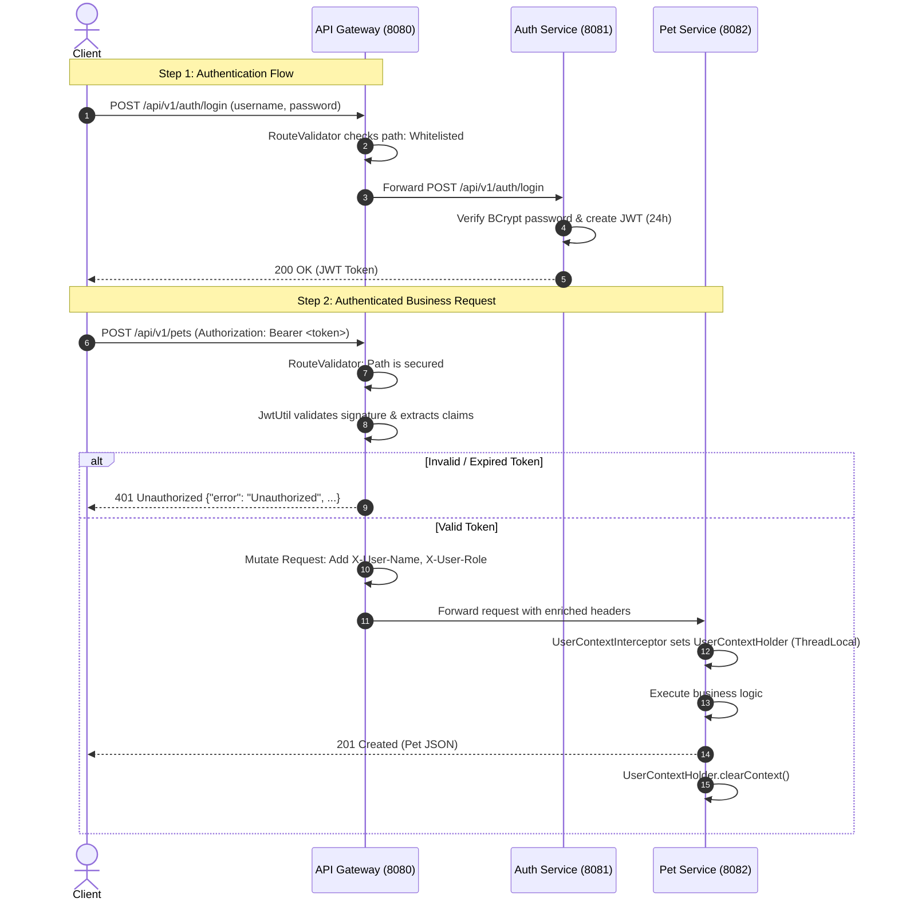
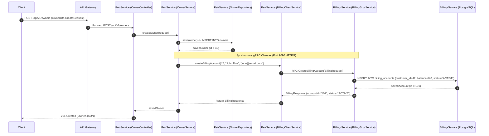
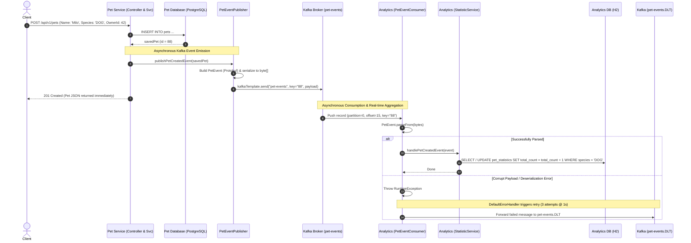

# Pet Clinic Management — System Architecture & Full Flow Documentation

This document provides an end-to-end technical breakdown of the **Pet Clinic Management** microservices ecosystem. It covers service responsibilities, API Gateway routing & security, synchronous inter-service communication via **gRPC**, asynchronous event streaming via **Apache Kafka (KRaft mode)** with **Protocol Buffers**, and database topologies.

---

## 1. High-Level Architecture Overview

The system is designed following a domain-driven microservices architecture:
* **API Gateway (`8080`)**: Central reactive reverse proxy with automated JWT validation and header enrichment.
* **Auth Service (`8081`)**: Identity and access management, issuing signed JWT tokens.
* **Pet Service (`8082`)**: Core domain service managing Owners, Pets, Medical Records, Vaccinations, Cages, Boarding, Spa, and Appointments.
* **Billing Service (`8083` HTTP, `9090` gRPC)**: Financial ledger and billing accounts management.
* **Analytics Service (`8084`)**: Event-driven real-time statistics aggregator.
* **Infrastructure**: Multi-database PostgreSQL 15, Kafka 7.6.1 in KRaft mode (no Zookeeper), and shared Protocol Buffers (`proto-common`).

```mermaid
flowchart TB
    Client["Client (Web / Mobile / Postman)"]

    subgraph Edge ["Edge Layer"]
        Gateway["API Gateway (Port 8080)<br/>Spring Cloud Gateway + WebFlux<br/>AuthenticationFilter"]
    end

    subgraph Microservices ["Business Services Layer"]
        Auth["Auth Service (Port 8081)<br/>Spring Boot / Spring Security"]
        Pet["Pet Service (Port 8082)<br/>Spring Boot / JPA / Flyway"]
        Billing["Billing Service (Port 8083, gRPC 9090)<br/>Spring Boot / gRPC Server"]
        Analytics["Analytics Service (Port 8084)<br/>Spring Boot / Kafka Consumer"]
    end

    subgraph Messaging ["Message Broker (KRaft Mode)"]
        KafkaBroker["Kafka Broker:9092<br/>Topic: 'pet-events'<br/>DLT: 'pet-events.DLT'"]
    end

    subgraph Storage ["Persistence Layer"]
        DB_Auth[(PostgreSQL<br/>petclinic_auth)]
        DB_Pets[(PostgreSQL<br/>pet_clinic_pets)]
        DB_Billing[(PostgreSQL<br/>pet_clinic_billing)]
        DB_Analytics[(H2 In-Memory<br/>analyticsdb)]
    end

    Client -->|HTTP REST| Gateway

    %% Gateway Routing
    Gateway -->|/api/v1/auth/**| Auth
    Gateway -->|/api/v1/pets/**, /owners/**, etc.| Pet
    Gateway -.->|/api/v1/analytics/**| Analytics

    %% Synchronous gRPC
    Pet -->|gRPC: CreateBillingAccount<br/>Port 9090 (HTTP/2)| Billing

    %% Asynchronous Kafka
    Pet -->|Publish PetEvent (Protobuf byte array)| KafkaBroker
    KafkaBroker -->|Consume PetEvent<br/>group: analytics-group| Analytics

    %% Databases
    Auth --> DB_Auth
    Pet --> DB_Pets
    Billing --> DB_Billing
    Analytics --> DB_Analytics
```

---

## 2. Service Inventory & Network Topology

| Component | Port(s) | Technology Stack | Database / Storage | Key Responsibilities |
|---|---|---|---|---|
| [**api-gateway**](file:///d:/pet-clinic-management/api-gateway) | `8080` (HTTP) | Spring Cloud Gateway (Reactive WebFlux), Java 17/25, JJWT | None | Single entry point, CORS management, JWT signature validation, header injection (`X-User-*`), request routing |
| [**auth-service**](file:///d:/pet-clinic-management/auth-service) | `8081` (HTTP) | Spring Boot 3, Spring Security, Spring Data JPA, PostgreSQL Driver | `petclinic_auth` (PostgreSQL) | User registration, credential verification, BCrypt hashing, JWT generation (`24h` expiration) |
| [**pet-service**](file:///d:/pet-clinic-management/pet-service) | `8082` (HTTP) | Spring Boot, Spring Data JPA, Flyway, `grpc-client-spring-boot-starter`, `spring-kafka` | `pet_clinic_pets` (PostgreSQL) | Clinic business logic: Pet, Owner, Appointment, Boarding, MedicalRecord, Spa. Calls Billing over gRPC, publishes Kafka events |
| [**billing-service**](file:///d:/pet-clinic-management/billing-service) | `8083` (HTTP)<br/>`9090` (gRPC) | Spring Boot, `grpc-server-spring-boot-starter`, Spring Data JPA | `pet_clinic_billing` (PostgreSQL) | Customer billing accounts, ledger balances, gRPC RPC implementation for instant account provisioning |
| [**analytics-service**](file:///d:/pet-clinic-management/analytics-service) | `8084` (HTTP) | Spring Boot, `spring-kafka`, Spring Data JPA, H2 | `analyticsdb` (H2 In-Memory) | Consumes Protobuf messages from Kafka, aggregates clinic metrics (e.g. pet counts per species), DLT error handling |
| [**proto-common**](file:///d:/pet-clinic-management/proto-common) | N/A (Shared Lib) | Protobuf 3 compiler, `protobuf-java`, `grpc-protobuf`, `grpc-stub` | N/A | Language-neutral binary message and gRPC service contracts compiled to Java |
| **Kafka Broker** | `9092` (Client)<br/>`9093` (Controller) | Confluent Platform Kafka 7.6.1 (KRaft Mode) | Internal log segments | High-throughput, distributed event streaming without Zookeeper |
| **PostgreSQL** | `5432` | PostgreSQL 15 Alpine | Multi-database container | Persistent relational storage with schema migrations |

---

## 3. API Gateway & Security Flow

The API Gateway acts as the gatekeeper for all incoming external traffic.

### 3.1 Gateway Architecture Components
* **[RouteValidator.java](file:///d:/pet-clinic-management/api-gateway/src/main/java/com/petclinic/apigateway/filter/RouteValidator.java)**:
  Defines an open-endpoints whitelist that bypasses token inspection:
  ```java
  public static final List<String> openApiEndpoints = List.of(
      "/api/v1/auth/register",
      "/api/v1/auth/login",
      "/v3/api-docs",
      "/swagger-ui",
      "/swagger-resources"
  );
  ```
* **[AuthenticationFilter.java](file:///d:/pet-clinic-management/api-gateway/src/main/java/com/petclinic/apigateway/filter/AuthenticationFilter.java)**:
  Inherits from `AbstractGatewayFilterFactory`. For any secured path:
  1. Checks for the presence of the `Authorization: Bearer <JWT>` header.
  2. Parses and verifies the HMAC-SHA256 signature using the shared secret key.
  3. Extracts claims: `username = claims.getSubject()` and `role = claims.get("role", String.class)`.
  4. **Downstream Header Enrichment**: Injects custom headers into the request forwarded to internal microservices:
     * `X-User-Name: <username>`
     * `X-User-Role: <role>`
  5. If validation fails, immediately short-circuits and returns HTTP `401 Unauthorized` with a JSON payload: `{"error": "Unauthorized", "message": "..."}`.
* **Downstream Context Interceptor in `pet-service`**:
  * [UserContextInterceptor.java](file:///d:/pet-clinic-management/pet-service/src/main/java/com/petclinic/petservice/filter/UserContextInterceptor.java) reads `X-User-Name`, `X-User-Role`, and `X-User-Id` from HTTP headers.
  * Stores context inside [UserContextHolder.java](file:///d:/pet-clinic-management/pet-service/src/main/java/com/petclinic/petservice/context/UserContextHolder.java) via `ThreadLocal`.
  * Cleans up after request completion (`afterCompletion`), preventing thread-pool context leakage.



---

## 4. Synchronous Inter-Service Communication via gRPC

When a new pet owner is registered, the system creates a corresponding financial billing account immediately via a synchronous, low-latency gRPC call.

### 4.1 Protocol Contract (`billing_service.proto`)
Located in [proto-common/.../billing_service.proto](file:///d:/pet-clinic-management/proto-common/src/main/proto/billing_service.proto):
```protobuf
syntax = "proto3";
package com.petclinic.billing.grpc;

option java_multiple_files = true;
option java_package = "com.petclinic.billing.grpc";

service BillingService {
  rpc CreateBillingAccount (BillingRequest) returns (BillingResponse);
}

message BillingRequest {
  string customer_id = 1;
  string customer_name = 2;
  string email = 3;
}

message BillingResponse {
  string account_id = 1;
  string status = 2;
  string message = 3;
}
```

### 4.2 Client Implementation (`pet-service`)
* Configured in [application.yml](file:///d:/pet-clinic-management/pet-service/src/main/resources/application.yml):
  ```yaml
  grpc:
    client:
      billing-service:
        address: 'static://billing-service:9090'
        negotiation-type: plaintext
  ```
* Implemented in [BillingClientService.java](file:///d:/pet-clinic-management/pet-service/src/main/java/com/petclinic/petservice/service/BillingClientService.java):
  * Uses `@GrpcClient("billing-service")` to inject `BillingServiceBlockingStub`.
  * Wraps the call in error handling: catches `StatusRuntimeException`.

### 4.3 Server Implementation (`billing-service`)
* Configured in [application.yml](file:///d:/pet-clinic-management/billing-service/src/main/resources/application.yml) listening on gRPC port `9090`.
* Implemented in [BillingGrpcService.java](file:///d:/pet-clinic-management/billing-service/src/main/java/com/petclinic/billingservice/service/BillingGrpcService.java):
  * Extends `BillingServiceImplBase` with `@GrpcService`.
  * Persists `BillingAccount` entity into PostgreSQL (`status = ACTIVE`, `balance = 0.00`).
  * Streams back `BillingResponse` via `responseObserver.onNext(response)` and `responseObserver.onCompleted()`.

### 4.4 Fault Tolerance & Non-Blocking Resilience Strategy
In [OwnerService.java](file:///d:/pet-clinic-management/pet-service/src/main/java/com/petclinic/petservice/service/OwnerService.java):
```java
try {
    billingClientService.createBillingAccount(savedOwner.getId(), savedOwner.getFullName(), savedOwner.getEmail());
} catch (Exception e) {
    log.warn("Không thể tạo tài khoản billing cho owner {}: {}. Sẽ không rollback.", savedOwner.getId(), e.getMessage());
    // Resilience decision: The primary Owner creation succeeds even if Billing Service is temporarily down
}
```
This prevents cascading failures where an outage in the secondary billing service blocks customer registration in the primary clinic service.



---

## 5. Asynchronous Event-Driven Architecture via Apache Kafka

When mutations occur in the Pet Service (such as a new pet being added), events are emitted asynchronously to Kafka. This decouples write-heavy clinical operations from analytical queries.

### 5.1 Protobuf Event Contract (`pet_events.proto`)
Located in [proto-common/.../pet_events.proto](file:///d:/pet-clinic-management/proto-common/src/main/proto/pet_events.proto):
```protobuf
syntax = "proto3";
package com.petclinic.events;

option java_multiple_files = true;
option java_package = "com.petclinic.events";

message PetEvent {
  string event_id = 1;
  string event_type = 2; // e.g. PET_CREATED, APPOINTMENT_COMPLETED, VACCINATION_SCHEDULED
  int64 timestamp = 3;
  int64 pet_id = 4;
  string pet_name = 5;
  string species = 6;
  string breed = 7;
  int64 owner_id = 8;
  double amount = 9;
}
```

### 5.2 Producer: `pet-service`
* **Configuration** in [application.yml](file:///d:/pet-clinic-management/pet-service/src/main/resources/application.yml):
  * `bootstrap-servers: kafka:9092`
  * `key-serializer`: `StringSerializer` (pet ID)
  * `value-serializer`: `ByteArraySerializer` (binary Protobuf)
  * `acks: all` (highest durability guarantee across in-sync replicas)
  * `retries: 3`
* **Publishing Mechanism** in [PetEventPublisher.java](file:///d:/pet-clinic-management/pet-service/src/main/java/com/petclinic/petservice/kafka/PetEventPublisher.java):
  * Builds the `PetEvent` Protobuf message and serializes it: `byte[] payload = event.toByteArray();`.
  * Uses `String.valueOf(pet.getId())` as the Kafka message key.
  * **Partition Affinity**: By keying on `petId`, Kafka guarantees that all lifecycle events for a specific pet are routed to the same partition, preserving strict chronological ordering.
  * Uses asynchronous sending via `CompletableFuture<SendResult<String, byte[]>>`. A callback registers on `whenComplete` to log offset confirmation or errors without holding up the caller.

### 5.3 Consumer & Error Handling: `analytics-service`
* **Consumer Group**: `analytics-group`
* **Topic**: `pet-events`
* **Deserialization** in [PetEventConsumer.java](file:///d:/pet-clinic-management/analytics-service/src/main/java/com/petclinic/analytics/kafka/PetEventConsumer.java):
  * Listens using `@KafkaListener(topics = "${app.kafka.topics.pet-events}", groupId = "analytics-group")`.
  * Parses binary bytes: `PetEvent event = PetEvent.parseFrom(record.value())`.
  * Routes by `event.getEventType()`:
    * If `"PET_CREATED"`: delegates to [StatisticService.java](file:///d:/pet-clinic-management/analytics-service/src/main/java/com/petclinic/analytics/service/StatisticService.java) to increment the species counter.
* **Dead Letter Topic (DLT) & Retry Pattern** in [KafkaConsumerConfig.java](file:///d:/pet-clinic-management/analytics-service/src/main/java/com/petclinic/analytics/config/KafkaConsumerConfig.java):
  * Uses `DefaultErrorHandler` configured with `FixedBackOff(1000L, 3L)` (3 retries with 1-second delay).
  * If the payload is unparseable (`InvalidProtocolBufferException`) or downstream processing fails after 3 attempts, `DeadLetterPublishingRecoverer` automatically publishes the failed message to `pet-events.DLT`, preserving partition numbering for debugging without blocking the main stream.



---

## 6. End-to-End User & Data Flow Scenarios

### Scenario A: New User Onboarding & Pet Registration

1. **User Sign Up**:
   * Request: `POST http://localhost:8080/api/v1/auth/register` with `{ username, password, email, role }`.
   * Result: Auth Service hashes password with BCrypt and inserts into `petclinic_auth.users`.
2. **User Login**:
   * Request: `POST http://localhost:8080/api/v1/auth/login` with `{ username, password }`.
   * Result: Auth Service returns signed JWT token.
3. **Register Owner (Triggers gRPC)**:
   * Request: `POST http://localhost:8080/api/v1/owners` with `Authorization: Bearer <JWT>`.
   * Gateway verifies JWT, injects `X-User-*` headers, routes to `pet-service`.
   * Pet Service creates Owner in `pet_clinic_pets.owners`.
   * Pet Service synchronously calls Billing Service gRPC on port `9090` -> creates billing account in `pet_clinic_billing.billing_accounts`.
4. **Register Pet (Triggers Kafka & Analytics)**:
   * Request: `POST http://localhost:8080/api/v1/pets` with `Authorization: Bearer <JWT>`.
   * Pet Service creates Pet in `pet_clinic_pets.pets`.
   * Pet Service publishes binary `PetEvent` to Kafka topic `pet-events`.
   * Analytics Service consumes event, updates `analyticsdb.pet_statistics`.
5. **View Clinic Analytics**:
   * Request: `GET http://localhost:8084/api/v1/analytics/summary` (or via Gateway).
   * Result: Returns aggregate JSON `{ totalPets: 1, breakdown: [ { species: "DOG", totalCount: 1 } ] }`.

---

## 7. Database Topology & Domain Schemas

```mermaid
erDiagram
    %% Auth Service DB
    USERS {
        bigint id PK
        varchar username UK
        varchar password
        varchar email
        varchar role
        timestamp created_at
    }

    %% Pet Service DB
    OWNERS {
        bigint id PK
        varchar full_name
        varchar phone_number UK
        varchar email
        text address
        timestamp created_at
    }
    PETS {
        bigint id PK
        varchar name
        varchar species
        varchar breed
        date date_of_birth
        varchar gender
        boolean is_neutered
        double weight
        text allergies
        bigint owner_id FK
        timestamp created_at
    }
    APPOINTMENTS {
        bigint id PK
        bigint pet_id FK
        varchar service_type
        timestamp appointment_date
        varchar status
        text notes
    }
    MEDICAL_RECORDS {
        bigint id PK
        bigint pet_id FK
        text reason
        text diagnosis
        text treatment
        date re_visit_date
    }
    VACCINATIONS {
        bigint id PK
        bigint pet_id FK
        varchar vaccine_name
        date administered_date
        date next_due_date
    }
    CAGES {
        bigint id PK
        varchar code UK
        varchar type
        varchar status
        decimal daily_rate
    }
    BOARDING_TICKETS {
        bigint id PK
        bigint pet_id FK
        bigint cage_id FK
        timestamp check_in_date
        timestamp expected_check_out_date
        varchar status
    }
    SPA_TICKETS {
        bigint id PK
        bigint pet_id FK
        jsonb services
        varchar status
        decimal estimated_price
    }

    %% Billing Service DB
    BILLING_ACCOUNTS {
        bigint id PK
        bigint customer_id
        decimal balance
        varchar status
        timestamp created_at
    }

    %% Analytics Service DB
    PET_STATISTICS {
        bigint id PK
        varchar species UK
        bigint total_count
        timestamp last_updated
    }

    OWNERS ||--o{ PETS : "has"
    PETS ||--o{ APPOINTMENTS : "schedules"
    PETS ||--o{ MEDICAL_RECORDS : "records"
    PETS ||--o{ VACCINATIONS : "receives"
    PETS ||--o{ BOARDING_TICKETS : "boards"
    CAGES ||--o{ BOARDING_TICKETS : "assigns"
    PETS ||--o{ SPA_TICKETS : "attends"
    OWNERS ..> BILLING_ACCOUNTS : "cross-service reference (customer_id)"
    PETS ..> PET_STATISTICS : "cross-service async stream (species)"
```

---

## 8. Summary of Architectural Design Highlights

1. **Protocol Hybridization**:
   * **REST / JSON** for client-to-gateway and external user facing interactions.
   * **gRPC / HTTP/2 / Protobuf** for high-throughput, low-latency, strongly-typed internal RPC (Pet -> Billing).
   * **Kafka / Protobuf** for event-driven asynchronous publish/subscribe with strict schema enforcement (Pet -> Analytics).
2. **Stateless Edge Security**:
   * Centralized JWT validation at the API Gateway keeps microservices decoupled from authentication logic while passing user context downstream via headers.
3. **Resilience & Fault Isolation**:
   * gRPC failures do not break the main transaction in `OwnerService`.
   * Kafka consumer implements a 3-attempt exponential/fixed backoff before quarantine to a Dead Letter Topic (`.DLT`), preventing poison-pill deadlocks.
4. **Partition-Key Ordering**:
   * Kafka messages are keyed by `petId`, guaranteeing that all events for a given pet are processed in order by the analytics engine.
5. **Database-per-Service**:
   * Each service owns its schema and isolated database instance (`petclinic_auth`, `pet_clinic_pets`, `pet_clinic_billing`, and in-memory `analyticsdb`), preventing direct cross-database coupling.
