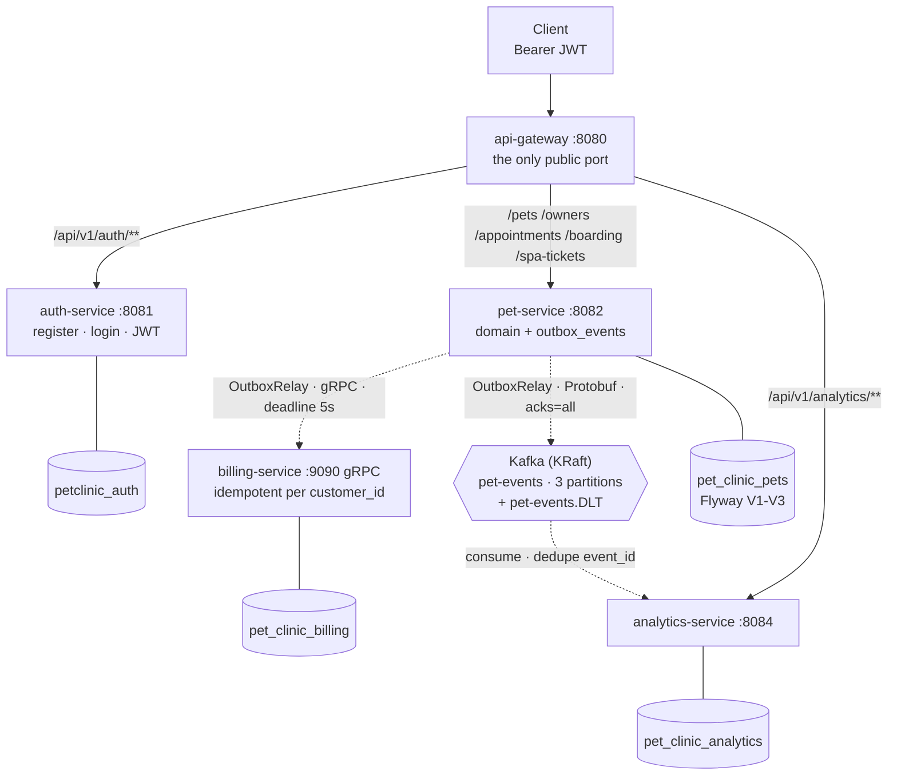
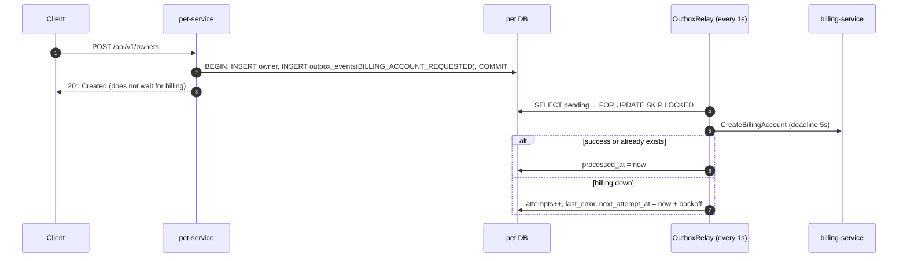

# Pet Clinic Management: event-driven microservices

A veterinary clinic backend: owners, pets, medical records, vaccinations, appointments, boarding and spa. It is built as **five Spring Boot services behind an API gateway**. Services talk **synchronously over gRPC** and **asynchronously over Kafka (Protobuf)**, and both paths go through a **Transactional Outbox**, so cross-service side effects happen only when the data has committed.


---

## Highlights

| Problem | How it is solved |
| --- | --- |
| **Dual write:** a DB insert plus a gRPC call or Kafka publish can half-succeed | **Transactional Outbox.** The side effect is stored as an `outbox_events` row in the *same* transaction as the business data. A relay delivers it after commit using `SELECT ... FOR UPDATE SKIP LOCKED` (safe with several instances), with exponential backoff (2s up to 5 min, max 10 attempts). |
| **At-least-once delivery means duplicates** | Every receiver is **idempotent**. billing-service dedupes on `customer_id` (unique; a concurrent insert resolves to the winner). analytics-service records `event_id` in `processed_events` in the same transaction as the counter. |
| **Trusting identity headers behind a gateway** | The gateway strips client-sent `X-User-*` on *every* route, verifies the JWT, then injects `X-User-Id/Name/Role`. Internal services expose no public ports, and pet-service rejects requests without gateway headers. The whitelist uses exact paths. |
| **Privilege escalation and leaked secrets** | Self-registration always creates `CUSTOMER`. The JWT secret comes only from the environment, with no default. Bad credentials return 401 and duplicates 409 (never 500). |
| **Poison messages and lost analytics** | `DefaultErrorHandler` retries 3 times, then sends the message to `pet-events.DLT`. Analytics state lives in PostgreSQL, not in-memory H2, so it survives restarts in step with Kafka offsets. |

## Architecture



Dashed arrows are asynchronous to the user's request: they start from the outbox relay, never from the HTTP request. Each service owns its database (database-per-service). The Protobuf contracts live in [`proto-common`](proto-common).

| Service | Responsibility |
| --- | --- |
| [`api-gateway`](api-gateway) | Routing, CORS, JWT verification, identity-header injection |
| [`auth-service`](auth-service) | Registration (`CUSTOMER` only), login, HS256 JWT with `userId` and `role` |
| [`pet-service`](pet-service) | Owners, pets, medical records, vaccinations, appointments, boarding (cages), spa; outbox + relay |
| [`billing-service`](billing-service) | Billing accounts over gRPC, idempotent |
| [`analytics-service`](analytics-service) | Pet counts per species from `pet-events`, idempotent consumer, DLT |
| [`proto-common`](proto-common) | `billing_service.proto`, `pet_events.proto` |

## How it works

### Creating an owner: outbox to gRPC



Adding a pet works the same way, except the relay publishes a `PetEvent`. It is keyed by `petId` (per-pet ordering), carries an `event_id` generated once, and is sent with `acks=all`, waiting for the broker ack. The full write-up is in [system_architecture_and_flow_docs.md](system_architecture_and_flow_docs.md).

## Tech stack

| Concern | Technology |
| --- | --- |
| Services | Java 17, Spring Boot 3.3, Spring Data JPA, Bean Validation, Lombok, MapStruct |
| Edge | Spring Cloud Gateway (WebFlux), JJWT |
| Sync RPC | gRPC (`grpc-spring-boot-starter`), Protobuf 3 |
| Async | Apache Kafka 7.6 in KRaft mode, Spring Kafka, Dead Letter Topic |
| Data | PostgreSQL 15 (one DB per service), Flyway (pet-service), JPA auditing |
| Testing | JUnit 5, Mockito, Spring `MockServerWebExchange`, `contextLoads` on PostgreSQL in CI |
| Delivery | Docker, Docker Compose (dev and prod), one GitHub Actions workflow per service (path-filtered) |

## Design decisions and trade-offs

| Decision | Why | Trade-off / alternative |
| --- | --- | --- |
| Microservices at all | To practise distributed-systems problems: dual writes, idempotency, contracts | For a real clinic this would be a **modular monolith**: fewer moving parts, local transactions |
| Polling outbox relay | No extra infrastructure; easy to reason about and test | At scale: CDC with Debezium reading the WAL (lower latency, no polling load) |
| gRPC for billing, Kafka for analytics | Billing returns a result to the caller; analytics just reacts to facts and can replay | Billing could also consume an `OwnerCreated` event now that it is asynchronous anyway |
| Header-based identity behind the gateway | Services stay simple; one place verifies tokens | Zero-trust alternative: mTLS between services, or forward the JWT and let each service verify it |
| HS256 shared secret | Simple for two services | RS256 with a JWKS endpoint: only auth-service can sign, keys can rotate |

## Getting started

**Prerequisites:** Docker. JDK 17 is needed only to run the tests.

```bash
cp .env.example .env
# set JWT_SECRET, e.g. openssl rand -base64 32
docker compose up --build
```

The gateway listens on `http://localhost:8080`. Try the main flow:

```bash
# 1. register and log in
curl -s -X POST localhost:8080/api/v1/auth/register -H 'Content-Type: application/json' \
  -d '{"username":"alice","password":"secret123","fullName":"Alice"}'
TOKEN=$(curl -s -X POST localhost:8080/api/v1/auth/login -H 'Content-Type: application/json' \
  -d '{"username":"alice","password":"secret123"}' | sed 's/.*"token":"\([^"]*\)".*/\1/')

# 2. create an owner (billing account follows via the outbox) and a pet (event goes to Kafka)
curl -s -X POST localhost:8080/api/v1/owners -H "Authorization: Bearer $TOKEN" -H 'Content-Type: application/json' \
  -d '{"fullName":"Nguyen Van A","phoneNumber":"0900000000","email":"a@example.com"}'
curl -s -X POST localhost:8080/api/v1/pets -H "Authorization: Bearer $TOKEN" -H 'Content-Type: application/json' \
  -d '{"name":"Milu","species":"DOG","ownerId":1}'

# 3. a second later, analytics has counted it
curl -s localhost:8080/api/v1/analytics/summary -H "Authorization: Bearer $TOKEN"
```

> Upgrading an existing Postgres volume? `postgres-init.sql` only runs on a fresh volume, so create the analytics DB once: `CREATE DATABASE pet_clinic_analytics;`

## Testing

```bash
(cd proto-common && mvn install -DskipTests)            # shared contracts first
for s in api-gateway auth-service billing-service analytics-service; do (cd $s && mvn test); done
(cd pet-service && ./mvnw test)                          # contextLoads needs PostgreSQL (CI provides it)
```

There are 26 unit tests, plus `contextLoads` in CI. The `contextLoads` run starts pet-service on PostgreSQL, so it also checks that the Flyway migrations match the entities (`ddl-auto: validate`).

| Service | What is covered |
| --- | --- |
| api-gateway | Spoofed `X-User-*` stripped on secured and open routes; missing or legacy tokens rejected; `contains()` whitelist bypass closed |
| auth-service | Self-registration always `CUSTOMER`; 401 and 409 instead of 500; `userId` in the token |
| pet-service | Relay success, failure with backoff, one bad row not blocking the batch, backoff cap; owner duplicate handling; gateway-header check |
| billing-service | Idempotent create, concurrent insert race, invalid id |
| analytics-service | Counts a new event once; ignores a redelivered one |

## Roadmap

- Role-based authorization inside pet-service (e.g. only `VET` writes medical records; customers see only their own pets).
- Distributed tracing across HTTP, gRPC and Kafka with OpenTelemetry, plus RED metrics.
- RS256 and JWKS; short-lived access tokens with refresh.
- Testcontainers end-to-end test of the full outbox flow.
- Outbox cleanup job, and alerts on rows that reach the attempt limit.
