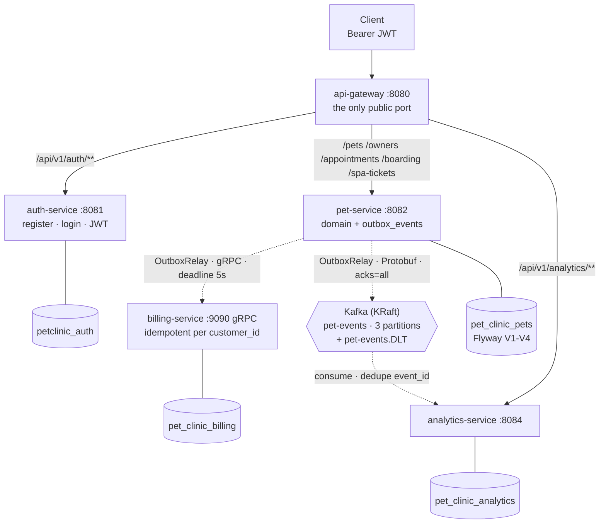
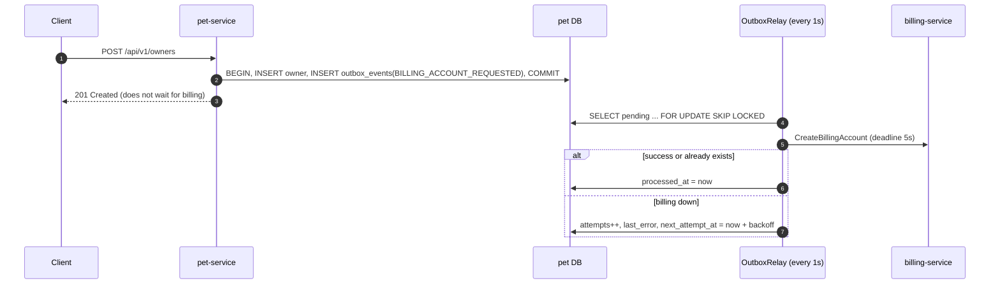

# Pet Clinic Management: event-driven microservices

A veterinary clinic backend: owners, pets, medical records, vaccinations, appointments, boarding and spa. It is built as **five Spring Boot services behind an API gateway**. Services talk **synchronously over gRPC** and **asynchronously over Kafka (Protobuf)**, and both paths go through a **Transactional Outbox**, so cross-service side effects happen only when the data has committed.


---

## Highlights

| Problem | How it is solved |
| --- | --- |
| **Dual write:** a DB insert plus a gRPC call or Kafka publish can half-succeed | **Transactional Outbox.** The side effect is stored as an `outbox_events` row in the *same* transaction as the business data. A relay delivers it after commit using `SELECT ... FOR UPDATE SKIP LOCKED` (safe with several instances), with exponential backoff (2s up to 5 min, max 10 attempts). |
| **At-least-once delivery means duplicates** | Every receiver is **idempotent**. billing-service dedupes on `customer_id` (unique; a concurrent insert resolves to the winner). analytics-service records `event_id` in `processed_events` in the same transaction as the counter. |
| **Trusting identity headers behind a gateway** | The gateway strips client-sent `X-User-*` on *every* route, verifies the JWT, then injects `X-User-Id/Name/Role`. Internal services expose no public ports, and pet-service rejects requests without gateway headers. The whitelist uses exact paths. |
| **Privilege escalation and leaked secrets** | Self-registration always creates `CUSTOMER`; staff accounts are created by an admin (`POST /api/v1/auth/staff`), and the first admin comes from the environment. The JWT secret comes only from the environment, with no default. Bad credentials return 401 and duplicates 409 (never 500). |
| **IDOR: every customer has the same role** | A role check alone would let any customer read another's pets by changing an id in the URL. pet-service runs Spring Security on the gateway headers: **role rules** with `@PreAuthorize` (`@StaffOnly`, `@ClinicalStaffOnly`), plus **ownership rules** in the services (`AccessGuard`): an owner profile is linked to the customer's account (`owners.user_id`), and every pet, owner and appointment access is checked against it. See [Authorization](#authorization). |
| **Double booking under concurrency** | Cage check-in used to read `status = AVAILABLE` and then write `OCCUPIED` without a lock, so concurrent requests could all get the same cage. Now the cage row is locked (`SELECT ... FOR UPDATE`) for the check, and **partial unique indexes** (`WHERE status = 'ACTIVE'`) make "one active stay per cage, one cage per pet" hold even for code that skips the lock. Appointment booking locks the pet row and rejects a second active appointment within 30 minutes. Both are proven by tests that fire 8 to 16 concurrent transactions at PostgreSQL. |
| **Illegal state changes** | Appointment and spa statuses are state machines (`canTransitionTo`): a completed visit can't go back to `PENDING`, a spa ticket can't skip `IN_PROGRESS`. Invalid transitions return 409. |
| **Poison messages and lost analytics** | `DefaultErrorHandler` retries 3 times, then sends the message to `pet-events.DLT`. Analytics state lives in PostgreSQL, not in-memory H2, so it survives restarts in step with Kafka offsets. |

## Architecture



Dashed arrows are asynchronous to the user's request: they start from the outbox relay, never from the HTTP request. Each service owns its database (database-per-service). The Protobuf contracts live in [`proto-common`](proto-common).

| Service | Responsibility |
| --- | --- |
| [`api-gateway`](api-gateway) | Routing, CORS, JWT verification, identity-header injection |
| [`auth-service`](auth-service) | Registration (`CUSTOMER` only), login, HS256 JWT with `userId` and `role`; admins create staff accounts, the first admin comes from the environment |
| [`pet-service`](pet-service) | Owners, pets, medical records, vaccinations, appointments, boarding (cages), spa; outbox + relay |
| [`billing-service`](billing-service) | Billing accounts over gRPC, idempotent |
| [`analytics-service`](analytics-service) | Pet counts per species from `pet-events`, idempotent consumer, DLT |
| [`proto-common`](proto-common) | `billing_service.proto`, `pet_events.proto` |

## How it works

### Creating an owner: outbox to gRPC



Adding a pet works the same way, except the relay publishes a `PetEvent`. It is keyed by `petId` (per-pet ordering), carries an `event_id` generated once, and is sent with `acks=all`, waiting for the broker ack. The full write-up is in [system_architecture_and_flow_docs.md](system_architecture_and_flow_docs.md).

## Tech stack

| Concern | Technology |
| --- | --- |
| Services | Java 17, Spring Boot 3.3, Spring Data JPA, Bean Validation, Lombok, MapStruct |
| Edge | Spring Cloud Gateway (WebFlux), JJWT |
| Sync RPC | gRPC (`grpc-spring-boot-starter`), Protobuf 3 |
| Async | Apache Kafka 7.6 in KRaft mode, Spring Kafka, Dead Letter Topic |
| Data | PostgreSQL 15 (one DB per service), Flyway (pet-service), JPA auditing |
| Testing | JUnit 5, Mockito; pet-service integration tests on embedded PostgreSQL (zonky) and an in-JVM Kafka broker (no Docker); Spring `MockServerWebExchange` for the gateway |
| Delivery | Docker, Docker Compose (dev and prod), one GitHub Actions workflow per service (path-filtered) |
| Kubernetes | Kustomize (`base` + `local`/`prod` overlays), StatefulSets for PostgreSQL and Kafka, probes on Spring Boot Actuator and native gRPC health, HPA, NetworkPolicy, a CronJob for outbox maintenance; CI deploys to kind and runs an end-to-end smoke test. See [docs/kubernetes.md](docs/kubernetes.md) |

## Design decisions and trade-offs

| Decision | Why | Trade-off / alternative |
| --- | --- | --- |
| Microservices at all | To practise distributed-systems problems: dual writes, idempotency, contracts | For a real clinic this would be a **modular monolith**: fewer moving parts, local transactions |
| Polling outbox relay | No extra infrastructure; easy to reason about and test | At scale: CDC with Debezium reading the WAL (lower latency, no polling load) |
| gRPC for billing, Kafka for analytics | Billing returns a result to the caller; analytics just reacts to facts and can replay | Billing could also consume an `OwnerCreated` event now that it is asynchronous anyway |
| Header-based identity behind the gateway | Services stay simple; one place verifies tokens | Zero-trust alternative: mTLS between services, or forward the JWT and let each service verify it |
| HS256 shared secret | Simple for two services | RS256 with a JWKS endpoint: only auth-service can sign, keys can rotate |

## Getting started

**Prerequisites:** Docker. JDK 17 is needed only to run the tests.

```bash
cp .env.example .env
# set JWT_SECRET (openssl rand -base64 32) and BOOTSTRAP_ADMIN_PASSWORD
docker compose up --build
```

`JWT_SECRET` must be base64 of at least 32 bytes: auth-service and the gateway refuse to start otherwise, instead of failing every login later. Without `BOOTSTRAP_ADMIN_PASSWORD` no admin is created, so nobody can create staff accounts.

The gateway listens on `http://localhost:8080`. Try the main flow:

```bash
login() { curl -s -X POST localhost:8080/api/v1/auth/login -H 'Content-Type: application/json' \
  -d "{\"username\":\"$1\",\"password\":\"$2\"}" | sed 's/.*"token":"\([^"]*\)".*/\1/'; }

# 1. a customer signs up and logs in
curl -s -X POST localhost:8080/api/v1/auth/register -H 'Content-Type: application/json' \
  -d '{"username":"alice","password":"secret123","fullName":"Alice"}'
TOKEN=$(login alice secret123)

# 2. her owner profile (linked to her account; billing account follows via the outbox)
#    and a pet (PET_CREATED goes to Kafka)
OWNER_ID=$(curl -s -X POST localhost:8080/api/v1/owners -H "Authorization: Bearer $TOKEN" -H 'Content-Type: application/json' \
  -d '{"fullName":"Nguyen Van A","phoneNumber":"0900000000","email":"a@example.com"}' | sed 's/.*"id":\([0-9]*\).*/\1/')
curl -s -X POST localhost:8080/api/v1/pets -H "Authorization: Bearer $TOKEN" -H 'Content-Type: application/json' \
  -d "{\"name\":\"Milu\",\"species\":\"DOG\",\"ownerId\":$OWNER_ID}"
curl -s localhost:8080/api/v1/pets/owner/$OWNER_ID -H "Authorization: Bearer $TOKEN"   # her pets

# another customer can't read them (403)
curl -s -X POST localhost:8080/api/v1/auth/register -H 'Content-Type: application/json' \
  -d '{"username":"bob","password":"secret123","fullName":"Bob"}'
curl -s -o /dev/null -w '%{http_code}\n' localhost:8080/api/v1/pets/owner/$OWNER_ID -H "Authorization: Bearer $(login bob secret123)"

# 3. a second later, analytics has counted it
curl -s localhost:8080/api/v1/analytics/summary -H "Authorization: Bearer $TOKEN"

# 4. staff: the bootstrap admin creates a vet, who can write medical records
ADMIN=$(login admin "$(grep '^BOOTSTRAP_ADMIN_PASSWORD=' .env | cut -d= -f2-)")
curl -s -X POST localhost:8080/api/v1/auth/staff -H "Authorization: Bearer $ADMIN" -H 'Content-Type: application/json' \
  -d '{"username":"vet1","password":"secret123","fullName":"Dr. Vet","role":"VET"}'
```

> Upgrading an existing Postgres volume? `postgres-init.sql` only runs on a fresh volume, so create the analytics DB once: `CREATE DATABASE pet_clinic_analytics;`. Migration V4 closes duplicate active boarding stays the old code allowed (it keeps the newest per pet and per cage) before adding its unique indexes; without that, pet-service would fail to start on such data. Owners created before V4 have no `user_id`, so only staff can see them until one is linked.

### On Kubernetes (kind)

**Prerequisites:** Docker, [kind](https://kind.sigs.k8s.io/) 0.24+, kubectl, openssl (on Windows: Git Bash or WSL). About 5 GB of RAM for Docker.

```bash
k8s/scripts/kind-up.sh       # create the cluster, build and load the images, deploy, wait for Ready
k8s/scripts/smoke-test.sh    # end-to-end: gateway, ownership 403, outbox -> gRPC/Kafka, NetworkPolicy, CronJob
k8s/scripts/kind-down.sh     # delete the cluster
```

The gateway is again at `http://localhost:8080`, so the `curl` commands above work unchanged. The guide (in Vietnamese) explains every Kubernetes feature used and why, with hands-on labs: [docs/kubernetes.md](docs/kubernetes.md).

## Authorization

The gateway authenticates (JWT); pet-service authorizes. Role rules sit on the controllers, ownership rules in the services, so a customer is limited both in *what* they can do and *whose* data they can touch.

| Endpoint | CUSTOMER | RECEPTIONIST | VET | ADMIN |
| --- | --- | --- | --- | --- |
| `POST /owners` | own profile only (linked to their account, one per account) | walk-in owners, may link an account | same | same |
| `GET /owners/me` | yes | | | |
| `GET /owners/{id}`, `GET /pets/owner/{id}` | own only | all | all | all |
| `GET /owners?phone=` | no | yes | yes | yes |
| `POST /pets` | to own profile only | yes | yes | yes |
| `PATCH /pets/{id}/health-info` | no | yes | yes | yes |
| `POST /pets/{id}/medical-records`, `/vaccinations` | no | no | yes | yes |
| `POST /appointments` | for own pets | yes | yes | yes |
| `PATCH /appointments/{id}/status` | cancel own only | any valid transition | same | same |
| `/boarding/**`, `/spa-tickets/**` | no | yes | yes | yes |

Wrong role or someone else's data: 403. No gateway headers: 401. A customer's 403 for another customer's id is decided before anything about that record is returned.

## Testing

```bash
(cd proto-common && mvn install -DskipTests)            # shared contracts first
for s in api-gateway auth-service billing-service analytics-service; do (cd $s && mvn test); done
(cd pet-service && ./mvnw verify)                        # no Docker or local Postgres needed
```

pet-service's integration tests start a real PostgreSQL (zonky embedded binaries) and an in-JVM Kafka broker, so row locks, partial unique indexes and the outbox relay run as in production, and Flyway V1-V4 are checked against the entities (`ddl-auto: validate`). An upgrade test migrates a database written by the previous release, with duplicate active stays, to V4. pet-service has 62 tests (16 of them on PostgreSQL); auth-service has 8, api-gateway 5, billing-service 4, analytics-service 2.

| Service | What is covered |
| --- | --- |
| api-gateway | Spoofed `X-User-*` stripped on secured and open routes; missing or legacy tokens rejected; `contains()` whitelist bypass closed |
| auth-service | Self-registration always `CUSTOMER`; only an admin creates staff; bootstrap admin is idempotent; 401 and 409 instead of 500; `userId` in the token |
| pet-service | **Concurrency:** 16 simultaneous check-ins for one cage → exactly one wins; one pet into 8 cages at once → one stay; 8 simultaneous bookings for one slot → one appointment. **Authorization over HTTP:** 401 without gateway headers, customer A gets 403 on customer B's owner, pets and appointments, role rules per endpoint. **Outbox end to end:** `PET_CREATED` reaches Kafka keyed by `petId`; billing down → retried with backoff → delivered. Plus unit tests for the relay, state machines, slot overlap and owner linking |
| billing-service | Idempotent create, concurrent insert race, invalid id |
| analytics-service | Counts a new event once; ignores a redelivered one |
| Kubernetes ([`ci-k8s.yml`](.github/workflows/ci-k8s.yml)) | Both overlays validated against the Kubernetes 1.31 schemas (kubeconform). Then a kind cluster in CI runs [`smoke-test.sh`](k8s/scripts/smoke-test.sh) across the deployed services: customer B gets 403, a new pet is counted by analytics (outbox → Kafka), the outbox drains and billing has the account (outbox → gRPC), an arbitrary pod cannot reach pet-service while a gateway-labelled one can, and the outbox CronJob succeeds |

## Roadmap

- Distributed tracing across HTTP, gRPC and Kafka with OpenTelemetry, plus RED metrics.
- RS256 and JWKS; short-lived access tokens with refresh.
- ~~Cross-service end-to-end test~~: done on kind in CI ([`smoke-test.sh`](k8s/scripts/smoke-test.sh)).
- ~~Outbox cleanup job, and alerts on rows that reach the attempt limit~~: done as the `outbox-maintenance` CronJob (the Job fails when dead rows exist). Still to do: route that failure to a real alert (Prometheus `kube_job_status_failed`).
- Kubernetes for production: managed PostgreSQL / Strimzi Kafka, images pushed to a registry by CI, External Secrets, per-call gRPC load balancing if billing scales out.
