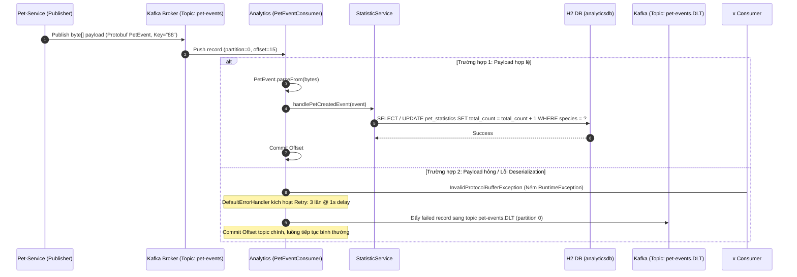

# 📊 Analytics Service - Dịch Vụ Phân Tích & Thống Kê Theo Thời Gian Thực

`analytics-service` là microservice thu thập, tổng hợp và phân tích dữ liệu theo hướng sự kiện (Event-Driven Real-time Analytics) trong hệ sinh thái **Pet Clinic Management System**. Service này tiêu thụ (consume) các luồng sự kiện nhị phân Protobuf từ **Apache Kafka**, cập nhật số liệu thống kê phòng khám theo thời gian thực và cung cấp API báo cáo tổng hợp cho ban quản lý.

---

## 📌 Mục Lục
1. [Tổng Quan Kiến Trúc & Công Nghệ](#-tổng-quan-kiến-trúc--công-nghệ)
2. [Các Tính Năng Cốt Lõi](#-các-tính-năng-cốt-lõi)
   - [1. Xử Lý Dòng Sự Kiện Kafka (Kafka Event Streaming)](#1-xử-lý-dòng-sự-kiện-kafka-kafka-event-streaming)
   - [2. Giải Mã Nhị Phân Protobuf Tốc Độ Cao](#2-giải-mã-nhị-phân-protobuf-tốc-độ-cao)
   - [3. Cơ Chế Chống Treo Luồng & Dead Letter Topic (DLT)](#3-cơ-chế-chống-treo-luồng--dead-letter-topic-dlt)
   - [4. Cung Cấp Báo Cáo Thống Kê REST API](#4-cung-cấp-báo-cáo-thống-kê-rest-api)
3. [Luồng Xử Lý Sự Kiện & DLT (Sequence Diagram)](#-luồng-xử-lý-sự-kiện--dlt-sequence-diagram)
4. [Mô Hình Dữ Liệu (In-Memory Database Schema)](#-mô-hình-dữ-liệu-in-memory-database-schema)
5. [Tài Liệu Chi Tiết REST API](#-tài-liệu-chi-tiết-rest-api)
6. [Cấu Trúc Mã Nguồn](#-cấu-trúc-mã-nguồn)
7. [Hướng Dẫn Cấu Hình & Khởi Chạy](#-hướng-dẫn-cấu-hình--khởi-chạy)

---

## 🏛 Tổng Quan Kiến Trúc & Công Nghệ

- **Ngôn ngữ & Runtime**: Java 17+, Spring Boot 3.x.
- **Message Broker**: **Apache Kafka (Confluent Platform 7.6.1)** chạy ở chế độ **KRaft Mode** (không phụ thuộc Zookeeper).
- **Tuần tự hóa Message**: **Google Protocol Buffers 3 (Protobuf)** từ module chia sẻ `proto-common`.
- **Cơ sở dữ liệu**: **H2 In-Memory Database** (Phục vụ truy vấn phân tích tức thời, có thể chuyển sang ClickHouse hoặc PostgreSQL ở môi trường Production).
- **ORM**: Spring Data JPA / Hibernate với H2 Dialect.
- **Port dịch vụ**: `8084` (H2 Console tại `http://localhost:8084/h2-console`).

---

## 🚀 Các Tính Năng Cốt Lõi

### 1. Xử Lý Dòng Sự Kiện Kafka (Kafka Event Streaming)
- Lắng nghe Kafka topic `pet-events` với Consumer Group `analytics-group`.
- Thiết lập `auto-offset-reset: earliest` đảm bảo đọc đầy đủ dữ liệu lịch sử khi khởi động trong môi trường phát triển.
- Nhận dạng bản ghi thông qua `ConsumerRecord<String, byte[]>`, cho phép truy cập đầy đủ metadata (topic, partition, offset, message key) phục vụ việc giám sát và truy vết luồng sự kiện phân tán.

### 2. Giải Mã Nhị Phân Protobuf Tốc Độ Cao
- Tiếp nhận payload dưới dạng mảng byte (`byte[]`) thô, giúp giảm thiểu tối đa kích thước gói tin mạng so với định dạng JSON.
- Giải mã trực tiếp thông qua lớp sinh mã `PetEvent.parseFrom(record.value())`.
- Phân loại và định tuyến theo thuộc tính `eventType`:
  - `PET_CREATED`: Kích hoạt phương thức cập nhật bộ đếm tăng trưởng của loài thú cưng tương ứng (`DOG`, `CAT`, `OTHER`...).
  - Các loại sự kiện mở rộng khác (`APPOINTMENT_COMPLETED`, `VACCINATION_SCHEDULED`) được ghi nhận warning log và bỏ qua an toàn.

### 3. Cơ Chế Chống Treo Luồng & Dead Letter Topic (DLT)
Được cấu hình tập trung trong `KafkaConsumerConfig.java`:
- **Chính sách Thử lại (Retry Policy)**: Khi gặp lỗi giải mã (`InvalidProtocolBufferException`) hoặc ngoại lệ xử lý dữ liệu, hệ thống tự động thử lại tối đa **3 lần** với khoảng nghỉ **1 giây** (`FixedBackOff(1000L, 3L)`).
- **Cô lập lỗi (DLT Quarantine)**: Nếu sau 3 lần vẫn thất bại (message bị hỏng hoặc payload độc hại - Poison Pill), `DeadLetterPublishingRecoverer` tự động đẩy thông điệp lỗi sang topic Dead Letter: `pet-events.DLT`.
- **Giữ nguyên Partition**: Message chuyển sang DLT giữ nguyên số partition ban đầu, bảo toàn ngữ cảnh để đội ngũ kỹ sư phân tích nguyên nhân gốc (RCA) mà không gây chặn luồng xử lý chính.

### 4. Cung Cấp Báo Cáo Thống Kê REST API
- Cung cấp endpoint báo cáo tổng hợp `/api/v1/analytics/summary` cho dashboard và hệ thống phân tích BI.
- Tổng hợp số lượng thú cưng theo từng loài (`species`) và tổng số thú cưng đã đăng ký trong toàn bộ phòng khám.

---

## 🔄 Luồng Xử Lý Sự Kiện & DLT (Sequence Diagram)



---

## 🗄 Mô Hình Dữ Liệu (In-Memory Database Schema)

Cơ sở dữ liệu in-memory: `analyticsdb` (H2 Database).

### Bảng `pet_statistics`
| Tên Cột | Kiểu Dữ Liệu | Ràng Buộc | Ý Nghĩa Nghiệp Vụ |
| :--- | :--- | :--- | :--- |
| `id` | `BIGINT` | PRIMARY KEY, AUTO_INCREMENT | Mã định danh bản ghi thống kê |
| `species` | `VARCHAR(255)` | NOT NULL, UNIQUE | Tên loài thú cưng (`DOG`, `CAT`, `BIRD`, `OTHER`...) |
| `total_count` | `BIGINT` | NOT NULL, DEFAULT `0` | Tổng số lượng thú cưng của loài này |
| `last_updated`| `TIMESTAMP` | NOT NULL | Thời điểm cập nhật thống kê gần nhất |

---

## 📡 Tài Liệu Chi Tiết REST API

Prefix chung: `/api/v1/analytics`

### 1. Lấy Báo Cáo Thống Kê Tổng Hợp (`GET /api/v1/analytics/summary`)
- **Mô tả**: Trả về tổng số thú cưng và chi tiết phân bổ số lượng theo từng loài.
- **Quyền hạn**: Public / Nội bộ.
- **Phản hồi mẫu (`200 OK`)**:
  ```json
  {
    "totalPets": 15,
    "breakdown": [
      {
        "id": 1,
        "species": "DOG",
        "totalCount": 10,
        "lastUpdated": "2026-10-18T10:00:00"
      },
      {
        "id": 2,
        "species": "CAT",
        "totalCount": 4,
        "lastUpdated": "2026-10-18T10:05:12"
      },
      {
        "id": 3,
        "species": "OTHER",
        "totalCount": 1,
        "lastUpdated": "2026-10-18T10:07:30"
      }
    ]
  }
  ```

---

## 📂 Cấu Trúc Mã Nguồn

```
analytics-service/
├── pom.xml                                   # Quản lý dependencies (spring-kafka, H2, JPA, proto-common)
├── Dockerfile                                # Dockerfile đóng gói container analytics-service
└── src/main/
    ├── java/com/petclinic/analytics/
    │   ├── AnalyticsApplication.java         # Main class khởi chạy ứng dụng
    │   ├── config/
    │   │   └── KafkaConsumerConfig.java      # Cấu hình DefaultErrorHandler, Retry & DLT Recoverer
    │   ├── controller/
    │   │   └── AnalyticsController.java      # REST Controller cung cấp endpoint /summary
    │   ├── entity/
    │   │   └── PetStatistic.java             # JPA Entity lưu trữ bộ đếm loài thú cưng
    │   ├── kafka/
    │   │   └── PetEventConsumer.java         # @KafkaListener lắng nghe, parse Protobuf & điều hướng
    │   ├── repository/
    │   │   └── PetStatisticRepository.java   # Spring Data JPA Repository (findBySpecies, ...)
    │   └── service/
    │       └── StatisticService.java         # Xử lý cập nhật số liệu và truy xuất báo cáo
    └── resources/
        └── application.yml                   # Cấu hình cổng (8084), H2 In-Memory, Kafka Consumer
```

---

## 🛠 Hướng Dẫn Cấu Hình & Khởi Chạy

### 1. Yêu Cầu Môi Trường
- **JDK 17** trở lên.
- **Apache Kafka Broker** (đang chạy tại `localhost:9092`).
- Thư viện **`proto-common`** đã được cài đặt vào local Maven cache.

### 2. Các Biến Môi Trường Cấu Hình Chính
| Tên Thuộc Tính / Biến Môi Trường | Mặc Định (Dev) | Ý Nghĩa |
| :--- | :--- | :--- |
| `server.port` | `8084` | Cổng HTTP lắng nghe của Analytics Service |
| `spring.kafka.consumer.bootstrap-servers` | `localhost:9092` | Địa chỉ Kafka Broker (`kafka:9092` trong Docker) |
| `spring.kafka.consumer.group-id` | `analytics-group` | Consumer Group ID |
| `app.kafka.topics.pet-events` | `pet-events` | Tên Topic lắng nghe sự kiện |
| `spring.datasource.url` | `jdbc:h2:mem:analyticsdb` | URL kết nối H2 In-Memory DB |

### 3. Quy Trình Khởi Chạy Local Development
1. Khởi chạy Kafka broker (qua Docker Compose):
   ```bash
   docker compose up -d kafka
   ```

2. Biên dịch hợp đồng chung `proto-common`:
   ```bash
   cd proto-common
   mvn clean install
   ```

3. Khởi chạy `analytics-service`:
   ```bash
   cd ../analytics-service
   mvn spring-boot:run
   ```

### 4. Truy Cập Giao Diện H2 Console
Khi ứng dụng đang chạy ở môi trường local, có thể truy cập giao diện quản trị cơ sở dữ liệu H2 để kiểm tra bảng `pet_statistics`:
- **URL**: `http://localhost:8084/h2-console`
- **JDBC URL**: `jdbc:h2:mem:analyticsdb`
- **User Name**: `sa`
- **Password**: `password`
