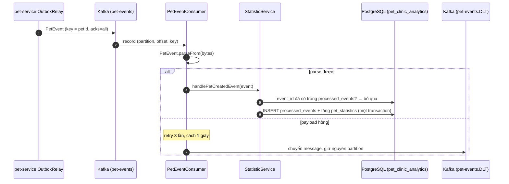

# 📊 Analytics Service - Thống kê từ sự kiện Kafka

`analytics-service` đọc sự kiện Protobuf trên topic `pet-events` của Kafka và đếm số thú cưng theo loài cho hệ thống **Pet Clinic Management**. Mỗi sự kiện chỉ được đếm một lần dù Kafka giao lặp, message hỏng được chuyển sang Dead Letter Topic, và số liệu nằm trong PostgreSQL nên không mất khi restart.

---

## 📌 Mục lục
1. [Tổng quan](#-tổng-quan)
2. [Xử lý sự kiện](#-xử-lý-sự-kiện)
3. [Luồng sự kiện và DLT](#-luồng-sự-kiện-và-dlt)
4. [Database](#-database)
5. [REST API](#-rest-api)
6. [Cấu hình và chạy](#-cấu-hình-và-chạy)
7. [Test](#-test)

---

## 🏛 Tổng quan

| Hạng mục | Chi tiết |
| :--- | :--- |
| Runtime | Java 17, Spring Boot 3.3, Spring Kafka |
| Đầu vào | Topic `pet-events`, consumer group `analytics-group`, value là `byte[]` của `PetEvent` (Protobuf, từ `proto-common`) |
| Database | PostgreSQL 15, database riêng `pet_clinic_analytics`, JPA `ddl-auto: update` |
| Cổng | `8084`, client gọi qua gateway `8080` |

## ⚙️ Xử lý sự kiện

1. `PetEventConsumer` nhận `ConsumerRecord<String, byte[]>` (key = `petId`) và parse bằng `PetEvent.parseFrom`.
2. `PET_CREATED` → `StatisticService.handlePetCreatedEvent`; loại sự kiện khác được log rồi bỏ qua.
3. **Idempotent:** trong cùng một transaction, nếu `event_id` đã có trong `processed_events` thì bỏ qua; chưa có thì ghi `event_id` và tăng bộ đếm của loài đó. pet-service giao **ít nhất một lần** (outbox relay gửi lại khi lỗi, consumer đọc lại sau khi chết), nên một sự kiện giao lặp vẫn chỉ được đếm một lần.
4. **Vì sao PostgreSQL thay vì H2 in-memory:** H2 mất số liệu khi restart trong khi Kafka vẫn nhớ offset đã commit, nên sự kiện cũ không bao giờ được đọc lại và thống kê sai vĩnh viễn.

### Retry và Dead Letter Topic
- Parse lỗi (payload hỏng) hoặc xử lý lỗi → `DefaultErrorHandler` thử lại 3 lần, cách nhau 1 giây (`FixedBackOff(1000, 3)`).
- Vẫn lỗi → `DeadLetterPublishingRecoverer` gửi message sang `pet-events.DLT`, **cùng partition**, để consumer đi tiếp thay vì kẹt mãi ở một "poison pill".
- Producer dùng cho DLT dùng chung `spring.kafka.bootstrap-servers` và `ByteArraySerializer` cho value. Bản cũ để producer mặc định `localhost:9092` và `StringSerializer`, nên DLT không hoạt động.

## 🔄 Luồng sự kiện và DLT



## 🗄 Database

| Bảng | Cột | Ghi chú |
| :--- | :--- | :--- |
| `pet_statistics` | `id`, `species` (`UNIQUE`), `total_count`, `last_updated` | Một dòng mỗi loài |
| `processed_events` | `event_id` (khóa chính), `processed_at` | Sự kiện đã đếm, để bỏ qua bản giao lặp |

Volume Postgres có từ trước khi thêm service này? `postgres-init.sql` chỉ chạy trên volume mới, nên tạo database một lần: `CREATE DATABASE pet_clinic_analytics;`.

## 📡 REST API

`GET /api/v1/analytics/summary` (qua gateway, cần JWT):

```json
{
  "totalPets": 3,
  "breakdown": [
    { "id": 1, "species": "DOG", "totalCount": 2, "lastUpdated": "2026-11-05T10:00:00" },
    { "id": 2, "species": "CAT", "totalCount": 1, "lastUpdated": "2026-11-05T10:05:00" }
  ]
}
```

## 🛠 Cấu hình và chạy

| Biến môi trường | Mặc định | Ý nghĩa |
| :--- | :--- | :--- |
| `DB_HOST`, `DB_PORT`, `DB_NAME`, `DB_USERNAME`, `DB_PASSWORD` | `localhost`, `5432`, `pet_clinic_analytics`, `petclinic_user`, `petclinic_password` | Hoặc `SPRING_DATASOURCE_URL` như compose |
| `SPRING_KAFKA_BOOTSTRAP_SERVERS` | `localhost:9092` | Dùng cho cả consumer lẫn producer của DLT (`kafka:9092` trong compose) |
| `APP_KAFKA_TOPICS_PET-EVENTS` | `pet-events` | Phải trùng với topic của pet-service |

```bash
(cd proto-common && mvn install -DskipTests)
docker compose up -d postgres-db kafka
cd analytics-service && mvn spring-boot:run
```

## ✅ Test

`mvn test`: 2 test của `StatisticService`: một sự kiện mới được đếm một lần; sự kiện giao lặp (cùng `event_id`) bị bỏ qua.
