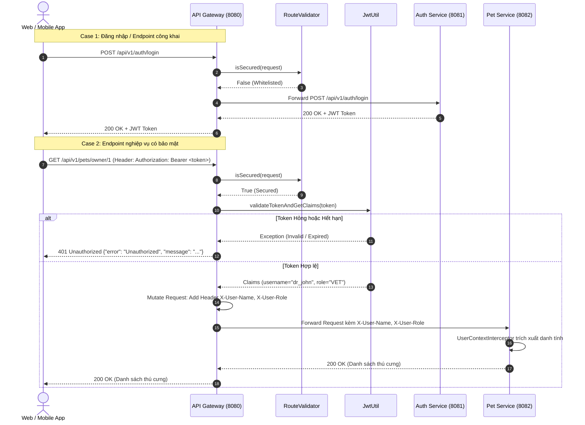

# 🚪 API Gateway - Cổng Điều Hướng & Bảo Mật Trung Tâm

`api-gateway` là thành phần biên (Edge Service / Reverse Proxy) trung tâm trong hệ thống **Pet Clinic Management System**. Xây dựng trên nền tảng reactive **Spring Cloud Gateway (Spring WebFlux)**, service này đóng vai trò là điểm tiếp nhận duy nhất (Single Point of Entry) cho toàn bộ traffic từ client (Web, Mobile, Postman), chịu trách nhiệm định tuyến thông minh, xác thực token tập trung và làm giàu context (Header Enrichment) cho các microservice nội bộ.

---

## 📌 Mục Lục
1. [Tổng Quan Kiến Trúc & Công Nghệ](#-tổng-quan-kiến-trúc--công-nghệ)
2. [Các Tính Năng Cốt Lõi](#-các-tính-năng-cốt-lõi)
   - [1. Định Tuyến Yêu Cầu (Request Routing)](#1-định-tuyến-yêu-cầu-request-routing)
   - [2. Bộ Lọc Xác Thực JWT Tập Trung (Authentication Filter)](#2-bộ-lọc-xác-thực-jwt-tập-trung-authentication-filter)
   - [3. Làm Giàu Header & Truyền Dẫn Ngữ Cảnh (Header Enrichment)](#3-làm-giàu-header--truyền-dẫn-ngữ-cảnh-header-enrichment)
   - [4. Quản Lý CORS Tập Trung (Global CORS)](#4-quản-lý-cors-tập-trung-global-cors)
3. [Luồng Xác Thực & Điều Hướng Chi Tiết](#-luồng-xác-thực--điều-hướng-chi-tiết)
4. [Bảng Định Tuyến Routes & Whitelist](#-bảng-định-tuyến-routes--whitelist)
5. [Cấu Trúc Mã Nguồn](#-cấu-trúc-mã-nguồn)
6. [Xử Lý Lỗi & Trạng Thái Trả Về](#-xử-lý-lỗi--trạng-thái-trả-về)
7. [Hướng Dẫn Cấu Hình & Khởi Chạy](#-hướng-dẫn-cấu-hình--khởi-chạy)

---

## 🏛 Tổng Quan Kiến Trúc & Công Nghệ

- **Ngôn ngữ & Runtime**: Java 17, Non-blocking I/O Reactive Engine (Project Reactor & Netty).
- **Framework**: **Spring Cloud Gateway 2023.x / Spring Boot 3.x** (`spring-boot-starter-webflux`, `spring-cloud-starter-gateway`).
- **Xác thực Token**: **JJWT (Java JWT)** version `0.11.5` (`jjwt-api`, `jjwt-impl`, `jjwt-jackson`).
- **Mã hóa chữ ký**: HMAC-SHA256 với secret key dùng chung 256-bit.
- **Port dịch vụ**: `8080` (Cổng public duy nhất ra Internet).

---

## 🚀 Các Tính Năng Cốt Lõi

### 1. Định Tuyến Yêu Cầu (Request Routing)
API Gateway phân giải đường dẫn URI và chuyển tiếp request đến đúng service đích:
- `/api/v1/auth/**` ➔ `auth-service` (Port `8081`)
- `/api/v1/pets/**`, `/api/v1/owners/**`, `/api/v1/medical-records/**`, `/api/v1/spa-tickets/**`, `/api/v1/boarding/**`, `/api/v1/appointments/**` ➔ `pet-service` (Port `8082`)
- `/api/v1/analytics/**` ➔ `analytics-service` (Port `8084`)

### 2. Bộ Lọc Xác Thực JWT Tập Trung (Authentication Filter)
- Triển khai thông qua `AuthenticationFilter` kế thừa `AbstractGatewayFilterFactory`.
- Tự động kiểm tra tính hợp lệ của access token trong header `Authorization: Bearer <token>`.
- **Whitelist Bypass**: Các endpoint công khai (Đăng ký, Đăng nhập, Swagger UI, OpenAPI Docs) được cấu hình trong `RouteValidator` sẽ được bỏ qua bước xác thực token.
- **Kiểm tra tính toàn vẹn**: Giải mã chữ ký HMAC-SHA256, kiểm tra thời gian hết hạn (`expiration`) và tính hợp lệ của claims.

### 3. Làm Giàu Header & Truyền Dẫn Ngữ Cảnh (Header Enrichment)
Khi token hợp lệ, Gateway trích xuất claims của người dùng và chèn vào HTTP Headers của request chuyển tiếp cho microservice phía sau:
- `X-User-Name`: Username của người gửi request (`claims.getSubject()`).
- `X-User-Role`: Quyền của người dùng (`ADMIN`, `VET`, `RECEPTIONIST`, `CUSTOMER`).
- `X-User-Id`: Mã định danh người dùng (nếu có trong token).

Nhờ cơ chế này, các backend service (`pet-service`, `billing-service`) không cần phải giải mã JWT hay phụ thuộc vào thư viện bảo mật phức tạp, chỉ cần đọc headers được Gateway ủy thác tin cậy.

### 4. Quản Lý CORS Tập Trung (Global CORS)
- Toàn bộ chính sách Cross-Origin Resource Sharing (CORS) được xử lý tập trung tại Gateway, giải quyết triệt để lỗi xung đột CORS đa tầng giữa Frontend và Backend.
- Cho phép các method: `GET`, `POST`, `PUT`, `DELETE`, `OPTIONS`.
- Cho phép tất cả các header và hỗ trợ mọi nguồn gốc (Origin) trong môi trường phát triển.

---

## 🔄 Luồng Xác Thực & Điều Hướng Chi Tiết



---

## 📋 Bảng Định Tuyến Routes & Whitelist

### 1. Cấu Hình Routing (`application.yml`)
| Route ID | Path Predicate | Target URI (Dev) | Target URI (Docker) | Áp Dụng Filter |
| :--- | :--- | :--- | :--- | :--- |
| `auth-service` | `/api/v1/auth/**` | `http://localhost:8081` | `http://auth-service:8081` | `AuthenticationFilter` |
| `pet-service` | `/api/v1/pets/**`<br/>`/api/v1/owners/**`<br/>`/api/v1/medical-records/**`<br/>`/api/v1/spa-tickets/**`<br/>`/api/v1/boarding/**`<br/>`/api/v1/appointments/**` | `http://localhost:8082` | `http://pet-service:8082` | `AuthenticationFilter` |
| `analytics-service` | `/api/v1/analytics/**` | `http://localhost:8084` | `http://analytics-service:8084` | Tùy chọn / Mở |

### 2. Danh Sách Endpoint Mở (Open Whitelist)
Được định nghĩa tại `RouteValidator.java`:
- `/api/v1/auth/register` (Đăng ký tài khoản mới)
- `/api/v1/auth/login` (Xác thực và lấy JWT)
- `/v3/api-docs` (OpenAPI specification endpoint)
- `/swagger-ui` (Giao diện Swagger UI tài liệu API)
- `/swagger-resources` (Tài nguyên tài liệu Swagger)

---

## 📂 Cấu Trúc Mã Nguồn

```
api-gateway/
├── pom.xml                               # Quản lý dependencies (Spring Cloud Gateway, JJWT)
├── Dockerfile                            # Dockerfile đóng gói container Gateway
└── src/main/
    ├── java/com/petclinic/apigateway/
    │   ├── ApiGatewayApplication.java    # Main Entry Point Spring Boot
    │   ├── filter/
    │   │   ├── AuthenticationFilter.java # GatewayFilter kiểm tra token & chèn X-User-*
    │   │   └── RouteValidator.java       # Whitelist các endpoint không yêu cầu xác thực
    │   └── util/
    │       └── JwtUtil.java              # Tiện ích giải mã HMAC-SHA256 & kiểm tra claims
    └── resources/
        └── application.yml               # Cấu hình cổng, CORS, Routes và JWT Secret
```

---

## 🛡 Xử Lý Lỗi & Trạng Thái Trả Về

Khi request không vượt qua được tầng bảo vệ của `AuthenticationFilter`, Gateway sẽ trực tiếp trả về HTTP `401 Unauthorized` dưới định dạng JSON chuẩn (không cần đi sâu vào backend):

```json
{
  "error": "Unauthorized",
  "message": "Missing authorization header"
}
```

Các tình huống lỗi phổ biến:
- **Thiếu Header**: `"Missing authorization header"` ➔ Client chưa truyền `Authorization`.
- **Sai Định Dạng**: `"Invalid authorization header format"` ➔ Header không bắt đầu bằng tiền tố `"Bearer "`.
- **Token Không Hợp Lệ**: `"Unauthorized access to application: JWT strings must contain exactly 2 period characters"` hoặc chữ ký không khớp.
- **Token Quá Hạn**: `"Unauthorized access to application: JWT expired at..."` ➔ Yêu cầu đăng nhập lại để lấy token mới.

---

## 🛠 Hướng Dẫn Cấu Hình & Khởi Chạy

### 1. Yêu Cầu Môi Trường
- **JDK 17** trở lên.
- **Maven 3.8+** (hoặc dùng wrapper).

### 2. Các Biến Môi Trường Cấu Hình Chính
| Tên Biến Môi Trường / Thuộc Tính | Giá Trị Mặc Định | Ý Nghĩa |
| :--- | :--- | :--- |
| `server.port` | `8080` | Cổng HTTP lắng nghe của Gateway |
| `jwt.secret` | `404E6352...` (256-bit Hex) | Khóa bí mật dùng chung để giải mã chữ ký JWT |
| `SPRING_CLOUD_GATEWAY_ROUTES_0_URI` | `http://localhost:8081` | Địa chỉ chuyển tiếp của `auth-service` |
| `SPRING_CLOUD_GATEWAY_ROUTES_1_URI` | `http://localhost:8082` | Địa chỉ chuyển tiếp của `pet-service` |
| `SPRING_CLOUD_GATEWAY_ROUTES_2_URI` | `http://localhost:8084` | Địa chỉ chuyển tiếp của `analytics-service` |

### 3. Chạy Độc Lập Cho Local Development
Từ thư mục gốc dự án:
```bash
cd api-gateway
mvn spring-boot:run
```

Hoặc qua tệp jar đã đóng gói:
```bash
mvn clean package -DskipTests
java -jar target/api-gateway-0.0.1-SNAPSHOT.jar
```

### 4. Kiểm Thử Hoạt Động (Smoke Test)
1. Thử gọi endpoint yêu cầu bảo mật khi chưa có token:
   ```bash
   curl -i http://localhost:8080/api/v1/pets
   ```
   *Kết quả mong đợi: HTTP 401 Unauthorized*.

2. Đăng nhập để lấy token qua Gateway:
   ```bash
   curl -X POST http://localhost:8080/api/v1/auth/login \
     -H "Content-Type: application/json" \
     -d '{"username":"admin","password":"password123"}'
   ```
   *Kết quả mong đợi: HTTP 200 OK kèm Bearer Token*.
