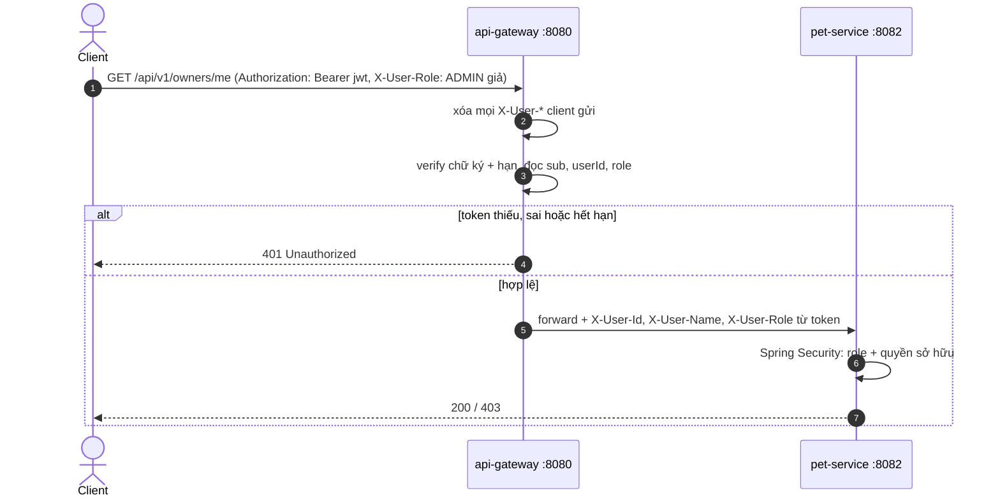

# 🚪 API Gateway - Cổng vào duy nhất

`api-gateway` là cổng public duy nhất (`8080`) của hệ thống **Pet Clinic Management**. Nó định tuyến request tới các service, verify JWT, và thay mọi header danh tính `X-User-*` mà client gửi bằng giá trị lấy từ token. Các service phía sau tin những header này, nên chúng không được mở cổng ra ngoài.

---

## 📌 Mục lục
1. [Tổng quan](#-tổng-quan)
2. [AuthenticationFilter](#-authenticationfilter)
3. [Luồng một request](#-luồng-một-request)
4. [Routes](#-routes)
5. [Cấu hình và chạy](#-cấu-hình-và-chạy)
6. [Test](#-test)

---

## 🏛 Tổng quan

| Hạng mục | Chi tiết |
| :--- | :--- |
| Runtime | Java 17, Spring Boot 3.3, Spring Cloud Gateway (WebFlux, reactive) |
| Token | JJWT 0.12, HS256, cùng secret với `auth-service` |
| Cổng | `8080`, cổng duy nhất được publish trong cả dev lẫn prod |
| CORS | `globalcors` cho mọi origin; an toàn vì xác thực bằng header `Authorization`, không dùng cookie |

## 🛡 AuthenticationFilter

Khai báo là `default-filters` nên chạy trên **mọi** route:

1. Xóa `X-User-Id`, `X-User-Name`, `X-User-Role` khỏi request, kể cả trên đường public. Không làm bước này thì ai cũng gọi được service với `X-User-Role: ADMIN`.
2. Đường public so khớp **chính xác** (bỏ dấu `/` cuối): chỉ `/api/v1/auth/register` và `/api/v1/auth/login`. Bản cũ dùng `contains()`, nên mọi URL chỉ cần chứa `/swagger-ui` (ví dụ `/api/v1/owners/swagger-ui`) là được bỏ qua xác thực.
3. Đường còn lại cần `Authorization: Bearer <jwt>`: verify chữ ký và hạn. Token thiếu claim `userId` hoặc `role` (token cũ) bị từ chối để buộc đăng nhập lại.
4. Hợp lệ → chèn `X-User-Id`, `X-User-Name`, `X-User-Role` từ claim rồi chuyển tiếp.
5. Lỗi → `401` với `{"error": "Unauthorized", "message": "..."}`; không trả chi tiết lỗi parse ra ngoài.

Gateway chỉ xác thực. Phân quyền theo role và theo quyền sở hữu dữ liệu nằm ở `pet-service`, vì chỉ service đó biết bản ghi thuộc về ai.

## 🔄 Luồng một request



## 🧭 Routes

| Route | Đường dẫn | Đích (biến môi trường, mặc định) |
| :--- | :--- | :--- |
| `auth-service` | `/api/v1/auth/**` | `AUTH_SERVICE_URL`, `http://localhost:8081` |
| `pet-service` | `/api/v1/pets/**` (gồm `/medical-records`, `/vaccinations`), `/api/v1/owners/**`, `/api/v1/appointments/**`, `/api/v1/boarding/**`, `/api/v1/spa-tickets/**` | `PET_SERVICE_URL`, `http://localhost:8082` |
| `analytics-service` | `/api/v1/analytics/**` | `ANALYTICS_SERVICE_URL`, `http://localhost:8084` |

Trong compose, ba biến trên trỏ tới `http://auth-service:8081`, `http://pet-service:8082`, `http://analytics-service:8084`.

## 🛠 Cấu hình và chạy

| Biến môi trường | Mặc định | Ý nghĩa |
| :--- | :--- | :--- |
| `JWT_SECRET` | **không có, bắt buộc** | Giống hệt `auth-service`. Thiếu, không phải base64 hoặc ngắn hơn 256 bit thì gateway dừng lúc khởi động, thay vì chạy rồi trả `401` cho mọi request |
| `AUTH_SERVICE_URL`, `PET_SERVICE_URL`, `ANALYTICS_SERVICE_URL` | xem bảng routes | Địa chỉ service phía sau |

```bash
cd api-gateway
JWT_SECRET=<cùng giá trị với auth-service> mvn spring-boot:run
```

Thử nhanh khi cả hệ thống đang chạy:

```bash
curl -i localhost:8080/api/v1/owners/me                  # 401: không có token
TOKEN=$(curl -s -X POST localhost:8080/api/v1/auth/login -H 'Content-Type: application/json' \
  -d '{"username":"alice","password":"secret123"}' | sed 's/.*"token":"\([^"]*\)".*/\1/')
curl -i localhost:8080/api/v1/owners/me -H "Authorization: Bearer $TOKEN"
```

## ✅ Test

`mvn test`: 5 test với `MockServerWebExchange` (không cần mạng). Kiểm tra: header `X-User-*` giả bị xóa trên cả route cần xác thực lẫn route public; thiếu token hoặc token cũ thiếu claim bị `401`; lỗ hổng whitelist kiểu `contains()` đã đóng.
