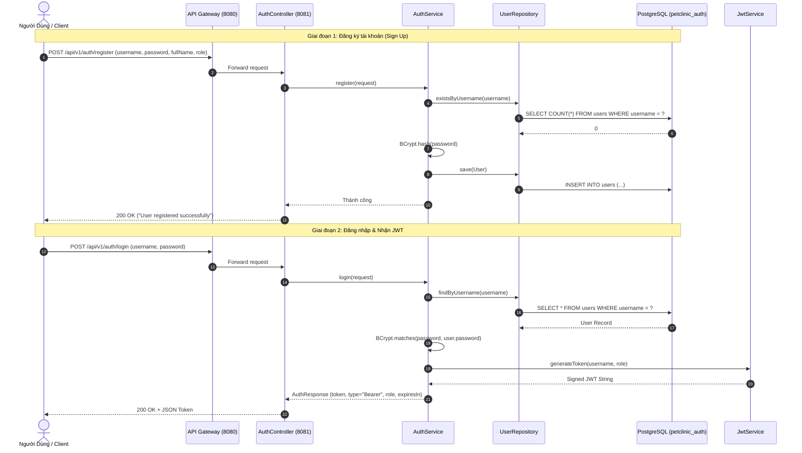

# 🔐 Auth Service - Dịch Vụ Định Danh & Quản Lý Truy Cập (IAM)

`auth-service` là microservice quản lý định danh người dùng và xác thực bảo mật (Identity & Access Management - IAM) trong hệ thống **Pet Clinic Management System**. Service này chịu trách nhiệm đăng ký tài khoản, mã hóa mật khẩu, xác thực thông tin đăng nhập, phát hành và kiểm tra tính hợp lệ của JSON Web Token (JWT) cho toàn bộ hệ thống.

---

## 📌 Mục Lục
1. [Tổng Quan Kiến Trúc & Công Nghệ](#-tổng-quan-kiến-trúc--công-nghệ)
2. [Các Tính Năng & Nghiệp Vụ](#-các-tính-năng--nghiệp-vụ)
   - [1. Đăng ký tài khoản (User Registration)](#1-đăng-ký-tài-khoản-user-registration)
   - [2. Đăng nhập & Cấp phát JWT (Authentication & JWT Issuance)](#2-đăng-nhập--cấp-phát-jwt-authentication--jwt-issuance)
   - [3. Xác minh tính hợp lệ của Token (Token Validation)](#3-xác-minh-tính-hợp-lệ-của-token-token-validation)
   - [4. Phân quyền người dùng (Role-Based Access Control - RBAC)](#4-phân-quyền-người-dùng-role-based-access-control---rbac)
3. [Luồng Nghiệp Vụ & Xác Thực (Sequence Diagram)](#-luồng-nghiệp-vụ--xác-thực-sequence-diagram)
4. [Mô Hình Cơ Sở Dữ Liệu (Database Schema)](#-mô-hình-cơ-sở-dữ-liệu-database-schema)
5. [Tài Liệu Chi Tiết REST API](#-tài-liệu-chi-tiết-rest-api)
6. [Cấu Trúc Mã Nguồn](#-cấu-trúc-mã-nguồn)
7. [Hướng Dẫn Cấu Hình & Khởi Chạy](#-hướng-dẫn-cấu-hình--khởi-chạy)

---

## 🏛 Tổng Quan Kiến Trúc & Công Nghệ

- **Ngôn ngữ & Runtime**: Java 17+, Spring Boot 3.x.
- **Bảo mật**: **Spring Security 6**, mã hóa mật khẩu một chiều bằng thuật toán **BCrypt** (`PasswordEncoder`).
- **Cơ chế Token**: **JJWT (Java JWT 0.11.5)** với thuật toán ký HMAC-SHA256.
- **Cơ sở dữ liệu**: **PostgreSQL 15** (Database riêng biệt: `petclinic_auth`).
- **ORM & Data Access**: Spring Data JPA / Hibernate với cấu hình tự động cập nhật schema (`ddl-auto: update`).
- **Validation**: Jakarta Bean Validation (`@Valid`, `@NotBlank`, `@Size`).
- **Port dịch vụ**: `8081` (Nội bộ) / Truy cập ngoại vi thông qua `api-gateway` (Port `8080`).

---

## 🚀 Các Tính Năng & Nghiệp Vụ

### 1. Đăng ký tài khoản (User Registration)
- Tiếp nhận yêu cầu đăng ký gồm: `username`, `password`, `fullName` và `role`.
- Kiểm tra tính duy nhất của `username` trong database: ngăn chặn trùng lặp tài khoản.
- Mã hóa mật khẩu an toàn bằng `BCryptPasswordEncoder` (độ dài chuỗi băm 60 ký tự) trước khi lưu trữ vào bảng `users`.
- Mặc định kích hoạt tài khoản ngay sau khi tạo (`enabled = true`).

### 2. Đăng nhập & Cấp phát JWT (Authentication & JWT Issuance)
- Tiếp nhận cặp thông tin xác thực `username` và `password`.
- Đối soát mật khẩu đã băm bằng `passwordEncoder.matches(rawPassword, encodedPassword)`.
- Kiểm tra trạng thái hoạt động của tài khoản (`enabled`).
- Tạo và phát hành JWT Token với thời hạn sống mặc định là **24 giờ** (`86,400,000 ms`).
- Cấu trúc Claims trong JWT Payload:
  - `sub`: `username` (Mã định danh người dùng đăng nhập).
  - `role`: Vai trò của người dùng (`ADMIN`, `VET`, `RECEPTIONIST`, `CUSTOMER`).
  - `iat`: Epoch timestamp phát hành token.
  - `exp`: Epoch timestamp hết hạn token.

### 3. Xác minh tính hợp lệ của Token (Token Validation)
- Cung cấp endpoint `/api/v1/auth/validate` cho các service nội bộ hoặc công cụ kiểm thử kiểm tra nhanh tính hợp lệ của token mà không cần giải mã thủ công.
- Tự động kiểm tra chữ ký HMAC-SHA256 và thời gian hết hạn (`isTokenValid`).

### 4. Phân quyền người dùng (Role-Based Access Control - RBAC)
Hệ thống định nghĩa 4 vai trò quyền hạn cụ thể (`Role` enum):
- `ADMIN`: Quản trị viên toàn quyền hệ thống phòng khám.
- `VET`: Bác sĩ thú y (khám chữa bệnh, kê đơn, tiêm phòng).
- `RECEPTIONIST`: Nhân viên lễ tân (tiếp đón, đặt lịch, check-in phòng, quản lý hóa đơn).
- `CUSTOMER`: Khách hàng / chủ nuôi thú cưng (xem thông tin thú cưng, lịch sử khám).

---

## 🔄 Luồng Nghiệp Vụ & Xác Thực (Sequence Diagram)



---

## 🗄 Mô Hình Cơ Sở Dữ Liệu (Database Schema)

Cơ sở dữ liệu: `petclinic_auth` trên PostgreSQL.

### Bảng `users`
| Tên Cột | Kiểu Dữ Liệu | Ràng Buộc | Ý Nghĩa Nghiệp Vụ |
| :--- | :--- | :--- | :--- |
| `id` | `BIGINT` | PRIMARY KEY, GENERATED ALWAYS AS IDENTITY | Mã định danh duy nhất của người dùng |
| `username` | `VARCHAR(255)` | NOT NULL, UNIQUE | Tên đăng nhập duy nhất của tài khoản |
| `password` | `VARCHAR(255)` | NOT NULL | Mật khẩu đã được mã hóa bằng BCrypt (độ dài 60 ký tự) |
| `full_name` | `VARCHAR(255)` | NULLABLE | Họ và tên đầy đủ của người dùng |
| `role` | `VARCHAR(50)` | NOT NULL | Vai trò: `ADMIN`, `VET`, `RECEPTIONIST`, `CUSTOMER` |
| `enabled` | `BOOLEAN` | NOT NULL, DEFAULT `true` | Trạng thái kích hoạt tài khoản |

---

## 📡 Tài Liệu Chi Tiết REST API

Prefix chung: `/api/v1/auth`

### 1. Đăng ký tài khoản (`POST /api/v1/auth/register`)
- **Mô tả**: Tạo mới người dùng trong hệ sinh thái phòng khám.
- **Quyền truy cập**: Public (Không cần token).
- **Request Body**:
  ```json
  {
    "username": "dr_alex",
    "password": "SecurePassword123!",
    "fullName": "Bác Sĩ Alex Trần",
    "role": "VET"
  }
  ```
  *(Các role hợp lệ: `ADMIN`, `VET`, `RECEPTIONIST`, `CUSTOMER`)*
- **Response**:
  - `200 OK`: `"User registered successfully"`
  - `400 Bad Request`: Thiếu dữ liệu hợp lệ (`@NotBlank`, `@Size`).
  - `500 / RuntimeException`: `"Username already exists"` khi username bị trùng lặp.

### 2. Đăng nhập hệ thống (`POST /api/v1/auth/login`)
- **Mô tả**: Xác thực tài khoản và phát hành JWT Token.
- **Quyền truy cập**: Public (Không cần token).
- **Request Body**:
  ```json
  {
    "username": "dr_alex",
    "password": "SecurePassword123!"
  }
  ```
- **Response**:
  - `200 OK`:
    ```json
    {
      "token": "eyJhbGciOiJIUzI1NiJ9.eyJzdWIiOiJkcl9hbGV4Iiwicm9sZSI6IlZFVCIsImlhdCI6MTcyOTI1NTIwMCwiZXhwIjoxNzI5MzQxNjAwfQ...",
      "type": "Bearer",
      "expiresIn": 86400000,
      "username": "dr_alex",
      "role": "VET"
    }
    ```
  - `500 / RuntimeException`: `"Invalid username or password"` hoặc `"User account is disabled"`.

### 3. Kiểm tra tính hợp lệ Token (`GET /api/v1/auth/validate`)
- **Mô tả**: Kiểm tra xem token có còn hợp lệ và đúng chữ ký không.
- **Headers**:
  - `Authorization: Bearer <JWT_TOKEN>`
- **Response**:
  - `200 OK`: `"Token is valid"`
  - `401 Unauthorized`: `"Invalid or missing token"`

---

## 📂 Cấu Trúc Mã Nguồn

```
auth-service/
├── pom.xml                                   # Quản lý dependencies (Spring Security, JPA, JJWT, Postgres)
├── Dockerfile                                # Docker containerfile cho auth-service
└── src/main/
    ├── java/com/petclinic/authservice/
    │   ├── AuthServiceApplication.java       # Main class khởi chạy Spring Boot
    │   ├── controller/
    │   │   └── AuthController.java           # Endpoint REST API (/register, /login, /validate)
    │   ├── dto/
    │   │   ├── AuthResponse.java             # Payload trả về khi đăng nhập thành công
    │   │   ├── LoginRequest.java             # Payload gửi lên khi đăng nhập
    │   │   └── RegisterRequest.java          # Payload gửi lên khi đăng ký tài khoản
    │   ├── entity/
    │   │   ├── Role.java                     # Enum quyền hạn (ADMIN, VET, RECEPTIONIST, CUSTOMER)
    │   │   └── User.java                     # JPA Entity ánh xạ bảng `users`
    │   ├── repository/
    │   │   └── UserRepository.java           # Spring Data JPA Repository thao tác bảng users
    │   ├── security/
    │   │   ├── JwtService.java               # Xử lý sinh và giải mã JSON Web Token (HMAC-SHA256)
    │   │   └── SecurityConfig.java           # Cấu hình Spring Security Filter Chain & BCrypt
    │   └── service/
    │       └── AuthService.java              # Nghiệp vụ đăng ký, kiểm tra mật khẩu & cấp token
    └── resources/
        └── application.yml                   # Cấu hình CSDL, JWT Secret & Expiration
```

---

## 🛠 Hướng Dẫn Cấu Hình & Khởi Chạy

### 1. Yêu Cầu Môi Trường
- **JDK 17** trở lên.
- **PostgreSQL 15** (đang chạy và đã tạo database `petclinic_auth`).

### 2. Các Biến Môi Trường Cấu Hình Chính
| Tên Thuộc Tính / Biến Môi Trường | Mặc Định (Dev) | Ý Nghĩa |
| :--- | :--- | :--- |
| `server.port` | `8081` | Cổng HTTP lắng nghe của Auth Service |
| `SPRING_DATASOURCE_URL` | `jdbc:postgresql://localhost:5432/petclinic_auth` | Chuỗi kết nối JDBC tới PostgreSQL |
| `SPRING_DATASOURCE_USERNAME` | `petclinic_user` | Tài khoản đăng nhập CSDL |
| `SPRING_DATASOURCE_PASSWORD` | `petclinic_password` | Mật khẩu đăng nhập CSDL |
| `jwt.secret` | `404E6352...` (256-bit Hex) | Khóa bí mật dùng để ký và giải mã JWT |
| `jwt.expiration-ms` | `86400000` (24 giờ) | Thời gian sống của token tính theo mili-giây |

### 3. Chạy Độc Lập Cho Local Development
1. Đảm bảo PostgreSQL đã chạy:
   ```bash
   docker compose up -d postgres-db
   ```
2. Chạy ứng dụng bằng Maven:
   ```bash
   cd auth-service
   mvn spring-boot:run
   ```

### 4. Kiểm Thử Nhanh Bằng cURL
- Đăng ký:
  ```bash
  curl -X POST http://localhost:8081/api/v1/auth/register \
    -H "Content-Type: application/json" \
    -d '{
      "username": "admin",
      "password": "password123",
      "fullName": "Quản Trị Viên",
      "role": "ADMIN"
    }'
  ```

- Đăng nhập:
  ```bash
  curl -X POST http://localhost:8081/api/v1/auth/login \
    -H "Content-Type: application/json" \
    -d '{
      "username": "admin",
      "password": "password123"
    }'
  ```
