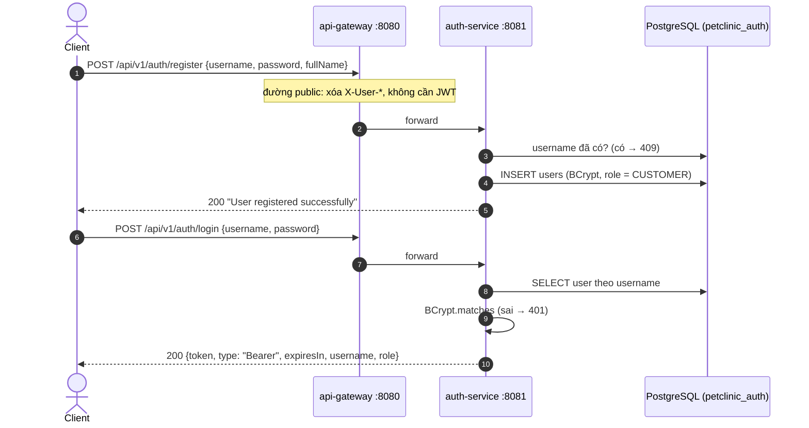

# 🔐 Auth Service - Định danh và cấp JWT

`auth-service` quản lý tài khoản của hệ thống **Pet Clinic Management**: đăng ký khách hàng, đăng nhập, ký JWT, cho admin tạo tài khoản nhân viên và tự tạo admin đầu tiên từ biến môi trường. Service chỉ nhận request qua `api-gateway`; gateway verify JWT cho mọi service khác.

---

## 📌 Mục lục
1. [Tổng quan](#-tổng-quan)
2. [Nghiệp vụ](#-nghiệp-vụ)
3. [Luồng đăng ký và đăng nhập](#-luồng-đăng-ký-và-đăng-nhập)
4. [Database](#-database)
5. [REST API](#-rest-api)
6. [Cấu hình và chạy](#-cấu-hình-và-chạy)
7. [Test](#-test)

---

## 🏛 Tổng quan

| Hạng mục | Chi tiết |
| :--- | :--- |
| Runtime | Java 17, Spring Boot 3.3 |
| Bảo mật | Spring Security 6 (stateless), mật khẩu băm bằng BCrypt |
| Token | JJWT 0.12, HS256, hạn mặc định 24 giờ, claim `sub` = username, `userId`, `role` |
| Database | PostgreSQL 15, database riêng `petclinic_auth`, JPA `ddl-auto: update` |
| Cổng | `8081`, chỉ trong mạng Docker (dev: bind `127.0.0.1`); client gọi qua gateway `8080` |

## 🚀 Nghiệp vụ

### 1. Đăng ký khách hàng
- `POST /api/v1/auth/register` nhận `username`, `password`, `fullName`. Request **không có trường `role`**: tài khoản tự đăng ký luôn là `CUSTOMER`. Bản cũ nhận `role` nên ai cũng tự đăng ký được thành `ADMIN`.
- Username trùng → `409 Conflict`.

### 2. Đăng nhập
- Sai username hoặc sai mật khẩu đều trả cùng một `401` (không dò được username nào tồn tại). Tài khoản bị khóa → `403`.
- Đúng → JWT HS256 chứa `sub` (username), `userId` (gateway chuyển thành `X-User-Id`), `role`, `iat`, `exp`.

### 3. Tài khoản nhân viên
- `POST /api/v1/auth/staff` tạo tài khoản `ADMIN`, `VET` hoặc `RECEPTIONIST`. Chỉ admin gọi được: service kiểm `X-User-Role` mà gateway đặt từ JWT đã verify (gateway luôn xóa bản client gửi). Người gọi không phải admin → `403`; role `CUSTOMER` → `400`.
- Endpoint này tin header của gateway, nên an toàn chỉ khi auth-service không lộ cổng ra ngoài (compose prod không publish, dev chỉ `127.0.0.1`).

### 4. Admin đầu tiên
- Đặt `BOOTSTRAP_ADMIN_USERNAME` và `BOOTSTRAP_ADMIN_PASSWORD`: lúc khởi động `AdminBootstrap` tạo admin nếu username đó chưa tồn tại. Chạy lại bao nhiêu lần cũng chỉ một admin.
- Để trống một trong hai thì không tạo gì. Khi đó không ai tạo được nhân viên, nên mọi endpoint chỉ dành cho nhân viên ở pet-service đều không dùng được.

### 5. Vai trò (`Role`)
`ADMIN`, `VET`, `RECEPTIONIST`, `CUSTOMER`. Quyền theo vai trò và theo quyền sở hữu dữ liệu được áp ở `pet-service` (xem mục *Authorization* trong [README gốc](../README.md#authorization)).

## 🔄 Luồng đăng ký và đăng nhập



## 🗄 Database

Bảng `users` (database `petclinic_auth`):

| Cột | Kiểu | Ràng buộc |
| :--- | :--- | :--- |
| `id` | `BIGINT` | khóa chính, tự tăng |
| `username` | `VARCHAR(255)` | `NOT NULL`, `UNIQUE` |
| `password` | `VARCHAR(255)` | `NOT NULL`, chuỗi BCrypt |
| `full_name` | `VARCHAR(255)` | `NOT NULL` |
| `role` | `VARCHAR(50)` | `NOT NULL`: `ADMIN`, `VET`, `RECEPTIONIST`, `CUSTOMER` |
| `enabled` | `BOOLEAN` | `NOT NULL`, mặc định `true` |
| `created_at` | `TIMESTAMP` | `NOT NULL`, đặt lúc tạo |

## 📡 REST API

Prefix `/api/v1/auth`. Gateway chỉ mở `register` và `login`; mọi đường khác cần `Authorization: Bearer <jwt>`.

| Method | Đường dẫn | Quyền | Kết quả |
| :--- | :--- | :--- | :--- |
| `POST` | `/register` | public | `200`; `400` thiếu trường; `409` trùng username |
| `POST` | `/login` | public | `200` kèm token; `401` sai thông tin; `403` tài khoản bị khóa |
| `POST` | `/staff` | ADMIN | `201`; `400` nếu role là `CUSTOMER`; `403` nếu không phải admin; `409` trùng username |
| `GET` | `/validate` | có JWT | `200 "Token is valid"` hoặc `401` |

Ví dụ phản hồi `login`:

```json
{
  "token": "eyJhbGciOiJIUzI1NiJ9...",
  "type": "Bearer",
  "expiresIn": 86400000,
  "username": "alice",
  "role": "CUSTOMER"
}
```

## 🛠 Cấu hình và chạy

| Biến môi trường | Mặc định | Ý nghĩa |
| :--- | :--- | :--- |
| `JWT_SECRET` | **không có, bắt buộc** | Base64 của ít nhất 32 byte ngẫu nhiên (`openssl rand -base64 32`), giống hệt giá trị của gateway. Thiếu, không phải base64 hoặc ngắn hơn 256 bit thì service dừng ngay lúc khởi động |
| `JWT_EXPIRATION_MS` | `86400000` (24 giờ) | Thời hạn token |
| `BOOTSTRAP_ADMIN_USERNAME`, `BOOTSTRAP_ADMIN_PASSWORD` | trống | Admin đầu tiên (xem trên) |
| `SPRING_DATASOURCE_URL` | `jdbc:postgresql://localhost:5432/petclinic_auth` | |
| `SPRING_DATASOURCE_USERNAME`, `SPRING_DATASOURCE_PASSWORD` | `petclinic_user` / `petclinic_password` | |

Cả hệ thống chạy bằng `docker compose up --build` ở thư mục gốc (xem [README gốc](../README.md#getting-started)). Chạy riêng service này:

```bash
docker compose up -d postgres-db
cd auth-service
JWT_SECRET=$(openssl rand -base64 32) BOOTSTRAP_ADMIN_USERNAME=admin BOOTSTRAP_ADMIN_PASSWORD=change-me mvn spring-boot:run
```

Thử nhanh qua gateway (cổng `8080`; `/staff` cần header `X-User-Role` do gateway đặt nên phải đi qua gateway):

```bash
curl -s -X POST localhost:8080/api/v1/auth/register -H 'Content-Type: application/json' \
  -d '{"username":"alice","password":"secret123","fullName":"Alice"}'
ADMIN=$(curl -s -X POST localhost:8080/api/v1/auth/login -H 'Content-Type: application/json' \
  -d '{"username":"admin","password":"change-me"}' | sed 's/.*"token":"\([^"]*\)".*/\1/')
curl -s -X POST localhost:8080/api/v1/auth/staff -H "Authorization: Bearer $ADMIN" -H 'Content-Type: application/json' \
  -d '{"username":"vet1","password":"secret123","fullName":"Dr. Vet","role":"VET"}'
```

## ✅ Test

`mvn test`: 8 test của `AuthService` (Mockito). Kiểm tra: tự đăng ký luôn là `CUSTOMER`; chỉ admin tạo được nhân viên và không tạo được `CUSTOMER` qua `/staff`; admin khởi tạo idempotent; sai thông tin trả `401`, trùng username trả `409` (không phải `500`); token chứa `userId`.
