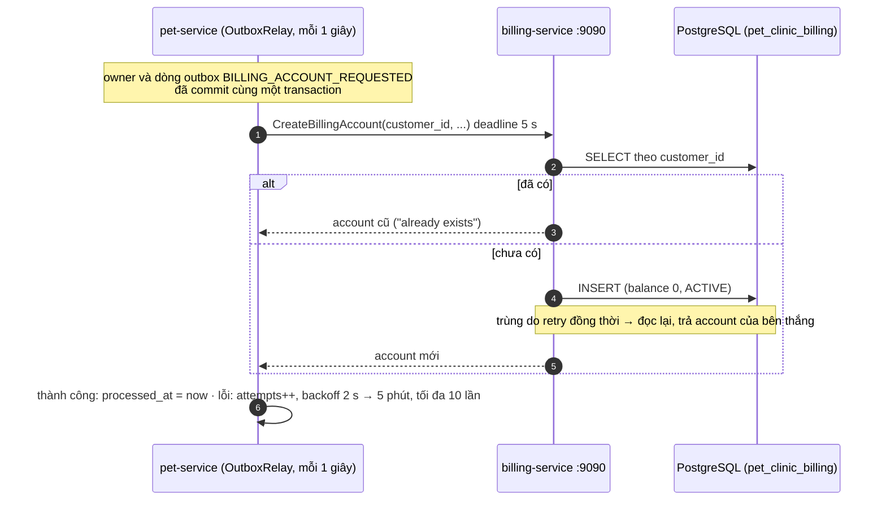

# 💳 Billing Service - Tài khoản thanh toán qua gRPC

`billing-service` giữ tài khoản thanh toán của từng chủ nuôi trong hệ thống **Pet Clinic Management**. Nó chỉ có một giao diện: gRPC server ở cổng `9090`, được `pet-service` gọi qua Transactional Outbox, không phải từ request của người dùng.

---

## 📌 Mục lục
1. [Tổng quan](#-tổng-quan)
2. [Hợp đồng gRPC](#-hợp-đồng-grpc)
3. [Idempotency](#-idempotency)
4. [Luồng tạo tài khoản](#-luồng-tạo-tài-khoản)
5. [Database](#-database)
6. [Cấu hình, chạy và thử](#-cấu-hình-chạy-và-thử)
7. [Test](#-test)

---

## 🏛 Tổng quan

| Hạng mục | Chi tiết |
| :--- | :--- |
| Runtime | Java 17, Spring Boot 3.3 |
| Giao tiếp | gRPC server (`grpc-server-spring-boot-starter`), Protobuf 3 từ `proto-common` |
| Database | PostgreSQL 15, database riêng `pet_clinic_billing`, JPA `ddl-auto: update` |
| Cổng | `9090` gRPC, `8083` HTTP (không có REST endpoint); chỉ trong mạng Docker |

## 📜 Hợp đồng gRPC

Định nghĩa trong [`proto-common/src/main/proto/billing_service.proto`](../proto-common/src/main/proto/billing_service.proto):

```protobuf
service BillingService {
  rpc CreateBillingAccount (BillingRequest) returns (BillingResponse);
}
message BillingRequest  { string customer_id = 1; string customer_name = 2; string email = 3; }
message BillingResponse { string account_id = 1; string status = 2; string message = 3; }
```

## ♻️ Idempotency

`pet-service` giao lời gọi này **ít nhất một lần**: relay của outbox gửi lại khi lỗi, và có thể gửi lại nếu nó chết sau khi gửi mà trước khi đánh dấu xong. Vì vậy `CreateBillingAccount` phải idempotent:

- `customer_id` không phải số → `INVALID_ARGUMENT`.
- Đã có tài khoản cho `customer_id` → trả lại tài khoản đó (`"Billing account already exists"`), không tạo thêm.
- Hai lần retry đến cùng lúc và cùng insert → unique constraint trên `customer_id` chặn một bên; bên đó đọc lại và trả tài khoản của bên thắng.
- Lỗi khác → `INTERNAL`; relay sẽ thử lại với exponential backoff.

## 🔄 Luồng tạo tài khoản



## 🗄 Database

Bảng `billing_accounts`:

| Cột | Kiểu | Ràng buộc |
| :--- | :--- | :--- |
| `id` | `BIGINT` | khóa chính, tự tăng |
| `customer_id` | `BIGINT` | `NOT NULL`, **`UNIQUE`** (một tài khoản mỗi chủ nuôi) |
| `balance` | `DECIMAL` | `NOT NULL`, bắt đầu bằng 0 |
| `status` | `VARCHAR` | `ACTIVE` hoặc `SUSPENDED` |
| `created_at` | `TIMESTAMP` | đặt lúc tạo |

## 🛠 Cấu hình, chạy và thử

| Biến môi trường | Mặc định (`application.yml`) |
| :--- | :--- |
| `SPRING_DATASOURCE_URL` | `jdbc:postgresql://localhost:5432/pet_clinic_billing` |
| `SPRING_DATASOURCE_USERNAME`, `SPRING_DATASOURCE_PASSWORD` | `postgres` / `password` (compose đặt `petclinic_user` / `petclinic_password`) |
| `GRPC_SERVER_PORT` | `9090` |

```bash
(cd proto-common && mvn install -DskipTests)   # hợp đồng chung trước
docker compose up -d postgres-db
cd billing-service && mvn spring-boot:run
```

Gọi thử bằng [grpcurl](https://github.com/fullstorydev/grpcurl) từ thư mục gốc repo (gọi hai lần: lần hai trả cùng `account_id`):

```bash
grpcurl -plaintext -import-path proto-common/src/main/proto -proto billing_service.proto \
  -d '{"customer_id":"1","customer_name":"Nguyen Van A","email":"a@example.com"}' \
  localhost:9090 com.petclinic.billing.grpc.BillingService/CreateBillingAccount
```

## ✅ Test

`mvn test`: 4 test của `BillingGrpcService`: tạo mới; gọi lại trả tài khoản cũ; hai lần insert đồng thời (unique constraint) trả tài khoản của bên thắng; `customer_id` không hợp lệ trả `INVALID_ARGUMENT`.
