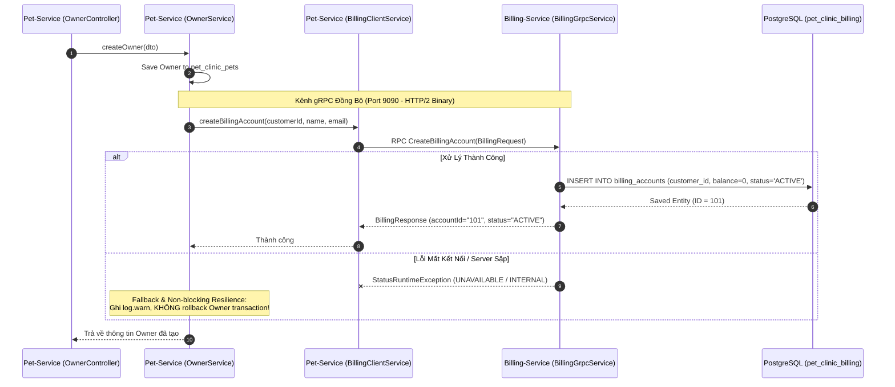

# 💳 Billing Service - Dịch Vụ Thanh Toán & Quản Lý Tài Khoản Viện Phí

`billing-service` là microservice quản lý tài chính và sổ cái viện phí (Financial & Billing Ledger) trong hệ thống **Pet Clinic Management System**. Service này chịu trách nhiệm quản lý tài khoản thanh toán của từng chủ sở hữu thú cưng, số dư công nợ, và cung cấp giao diện giao tiếp đồng bộ hiệu năng cao thông qua **gRPC Server** (Port `9090`) cho các microservice nghiệp vụ nội bộ.

---

## 📌 Mục Lục
1. [Tổng Quan Kiến Trúc & Công Nghệ](#-tổng-quan-kiến-trúc--công-nghệ)
2. [Các Tính Năng Cốt Lõi](#-các-tính-năng-cốt-lõi)
   - [1. Khởi Tạo Tài Khoản Thanh Toán Tự Động Qua gRPC](#1-khởi-tạo-tài-khoản-thanh-toán-tự-động-qua-grpc)
   - [2. Quản Lý Trạng Thái & Số Dư Công Nợ](#2-quản-lý-trạng-thái--số-dư-công-nợ)
3. [Giao Thức gRPC Inter-Service Chi Tiết](#-giao-thức-grpc-inter-service-chi-tiết)
   - [Protobuf Contract (`billing_service.proto`)](#protobuf-contract-billing_serviceproto)
   - [Triển Khai Server (`BillingGrpcService`)](#triển-khai-server-billinggrpcservice)
   - [Mô Hình Chịu Lỗi & Cách Ly Thất Bại](#mô-hình-chịu-lỗi--cách-ly-thất-bại)
4. [Mô Hình Cơ Sở Dữ Liệu (Database Schema)](#-mô-hình-cơ-sở-dữ-liệu-database-schema)
5. [Cấu Trúc Mã Nguồn](#-cấu-trúc-mã-nguồn)
6. [Hướng Dẫn Cấu Hình & Khởi Chạy](#-hướng-dẫn-cấu-hình--khởi-chạy)

---

## 🏛 Tổng Quan Kiến Trúc & Công Nghệ

- **Ngôn ngữ & Runtime**: Java 17+, Spring Boot 3.x.
- **gRPC Server Engine**: **`grpc-server-spring-boot-starter:3.1.0.RELEASE`** chạy trên giao thức truyền tải nhị phân đa luồng **HTTP/2**.
- **Protobuf Module**: Tích hợp trực tiếp từ thư viện chia sẻ nội bộ `proto-common`.
- **Cơ sở dữ liệu**: **PostgreSQL 15** (Database riêng biệt: `pet_clinic_billing`).
- **ORM & Data Access**: Spring Data JPA / Hibernate (`ddl-auto: update`).
- **Cổng kết nối**:
  - **gRPC Server Port**: `9090` (Kênh giao tiếp đồng bộ nội bộ giữa các microservice).
  - **HTTP REST Port**: `8083` (Quản lý actuator, metrics và REST API mở rộng).

---

## 🚀 Các Tính Năng Cốt Lõi

### 1. Khởi Tạo Tài Khoản Thanh Toán Tự Động Qua gRPC
- Khi một chủ thú cưng (`Owner`) mới được đăng ký tại `pet-service`, service này tự động kích hoạt lời gọi gRPC `CreateBillingAccount` sang `billing-service`.
- Khởi tạo ngay một bản ghi tài khoản viện phí (`BillingAccount`) với:
  - `customerId`: Mã định danh chủ nuôi từ `pet-service`.
  - `balance`: Khởi tạo mặc định bằng `0.00`.
  - `status`: Kích hoạt trạng thái `ACTIVE`.
  - `createdAt`: Tự động gán thời gian tạo bản ghi.

### 2. Quản Lý Trạng Thái & Số Dư Công Nợ
- Hỗ trợ các trạng thái tài khoản (`Status` enum):
  - `ACTIVE`: Tài khoản đang hoạt động, sẵn sàng thanh toán chi phí khám, thuốc, spa hoặc lưu chuồng.
  - `SUSPENDED`: Tài khoản tạm ngưng giao dịch (quá hạn công nợ hoặc vi phạm chính sách).
- Trường `balance` lưu trữ số dư tài khoản theo kiểu số học chính xác cao `BigDecimal`, tránh sai số làm tròn tài chính.

---

## ⚡ Giao Thức gRPC Inter-Service Chi Tiết

### Protobuf Contract (`billing_service.proto`)
Hợp đồng giao tiếp được định nghĩa trong module `proto-common`:

```protobuf
syntax = "proto3";
package com.petclinic.billing.grpc;

option java_multiple_files = true;
option java_package = "com.petclinic.billing.grpc";

service BillingService {
  rpc CreateBillingAccount (BillingRequest) returns (BillingResponse);
}

message BillingRequest {
  string customer_id = 1;
  string customer_name = 2;
  string email = 3;
}

message BillingResponse {
  string account_id = 1;
  string status = 2;
  string message = 3;
}
```

### Triển Khai Server (`BillingGrpcService`)
Service triển khai kế thừa lớp sinh mã `BillingServiceGrpc.BillingServiceImplBase` và được đánh dấu với annotation `@GrpcService`:

```java
@GrpcService
public class BillingGrpcService extends BillingServiceGrpc.BillingServiceImplBase {

    private final BillingAccountRepository billingAccountRepository;

    @Override
    public void createBillingAccount(BillingRequest request, StreamObserver<BillingResponse> responseObserver) {
        try {
            Long customerId = Long.parseLong(request.getCustomerId());
            BillingAccount newAccount = BillingAccount.builder()
                    .customerId(customerId)
                    .balance(BigDecimal.ZERO)
                    .status(BillingAccount.Status.ACTIVE)
                    .build();

            BillingAccount savedAccount = billingAccountRepository.save(newAccount);

            BillingResponse response = BillingResponse.newBuilder()
                    .setAccountId(String.valueOf(savedAccount.getId()))
                    .setStatus(savedAccount.getStatus().name())
                    .setMessage("Billing account created successfully")
                    .build();

            responseObserver.onNext(response);
            responseObserver.onCompleted();

        } catch (Exception e) {
            responseObserver.onError(
                    Status.INTERNAL
                            .withDescription("Failed to create billing account: " + e.getMessage())
                            .withCause(e)
                            .asRuntimeException()
            );
        }
    }
}
```

### Mô Hình Giao Tiếp & Chịu Lỗi (Resilience Flow)



---

## 🗄 Mô Hình Cơ Sở Dữ Liệu (Database Schema)

Cơ sở dữ liệu: `pet_clinic_billing` trên PostgreSQL.

### Bảng `billing_accounts`
| Tên Cột | Kiểu Dữ Liệu | Ràng Buộc | Ý Nghĩa Nghiệp Vụ |
| :--- | :--- | :--- | :--- |
| `id` | `BIGINT` | PRIMARY KEY, IDENTITY | Mã định danh duy nhất của tài khoản thanh toán |
| `customer_id` | `BIGINT` | NOT NULL | Mã ID của chủ nuôi thú cưng (`Owner.id` từ `pet-service`) |
| `balance` | `NUMERIC(19, 2)` | NOT NULL, DEFAULT `0.00` | Số dư khả dụng / nợ tồn đọng (kiểu BigDecimal) |
| `status` | `VARCHAR(50)` | NOT NULL | Trạng thái tài khoản: `ACTIVE`, `SUSPENDED` |
| `created_at` | `TIMESTAMP` | NOT NULL, UP-DATABLE: FALSE | Thời điểm khởi tạo tài khoản |

---

## 📂 Cấu Trúc Mã Nguồn

```
billing-service/
├── pom.xml                                     # Quản lý dependencies (grpc-server-starter, JPA, Postgres, proto-common)
├── Dockerfile                                  # Containerfile đóng gói billing-service
└── src/main/
    ├── java/com/petclinic/billingservice/
    │   ├── BillingServiceApplication.java      # Main entry point Spring Boot
    │   ├── entity/
    │   │   └── BillingAccount.java             # JPA Entity quản lý tài khoản viện phí
    │   ├── repository/
    │   │   └── BillingAccountRepository.java   # Spring Data JPA Repository
    │   └── service/
    │       └── BillingGrpcService.java         # Triển khai gRPC Service kế thừa BillingServiceImplBase
    └── resources/
        └── application.yml                     # Cấu hình cổng HTTP (8083), gRPC (9090) và CSDL
```

---

## 🛠 Hướng Dẫn Cấu Hình & Khởi Chạy

### 1. Yêu Cầu Môi Trường
- **JDK 17** trở lên.
- **PostgreSQL 15** (đã khởi tạo database `pet_clinic_billing`).
- Module **`proto-common`** đã được build và cài đặt vào local Maven (`mvn clean install` tại thư mục `proto-common`).

### 2. Các Biến Môi Trường Cấu Hình Chính
| Tên Thuộc Tính / Biến Môi Trường | Mặc Định (Dev) | Ý Nghĩa |
| :--- | :--- | :--- |
| `server.port` | `8083` | Cổng HTTP REST / Actuator |
| `grpc.server.port` | `9090` | Cổng dịch vụ gRPC HTTP/2 |
| `SPRING_DATASOURCE_URL` | `jdbc:postgresql://localhost:5432/pet_clinic_billing` | URL kết nối PostgreSQL |
| `SPRING_DATASOURCE_USERNAME` | `postgres` / `petclinic_user` | Tên đăng nhập cơ sở dữ liệu |
| `SPRING_DATASOURCE_PASSWORD` | `password` / `petclinic_password` | Mật khẩu cơ sở dữ liệu |

### 3. Quy Trình Khởi Chạy Local Development
1. Build mã nguồn Protobuf chung trước:
   ```bash
   cd proto-common
   mvn clean install
   ```

2. Khởi chạy PostgreSQL:
   ```bash
   docker compose up -d postgres-db
   ```

3. Chạy `billing-service`:
   ```bash
   cd ../billing-service
   mvn spring-boot:run
   ```

### 4. Kiểm Thử gRPC Bằng `grpcurl`
Sử dụng công cụ dòng lệnh `grpcurl` để kiểm tra kết nối gRPC port 9090:
```bash
grpcurl -plaintext \
  -d '{"customer_id": "1", "customer_name": "Nguyen Van A", "email": "a@gmail.com"}' \
  localhost:9090 \
  com.petclinic.billing.grpc.BillingService/CreateBillingAccount
```

*Kết quả mong đợi:*
```json
{
  "account_id": "1",
  "status": "ACTIVE",
  "message": "Billing account created successfully"
}
```
