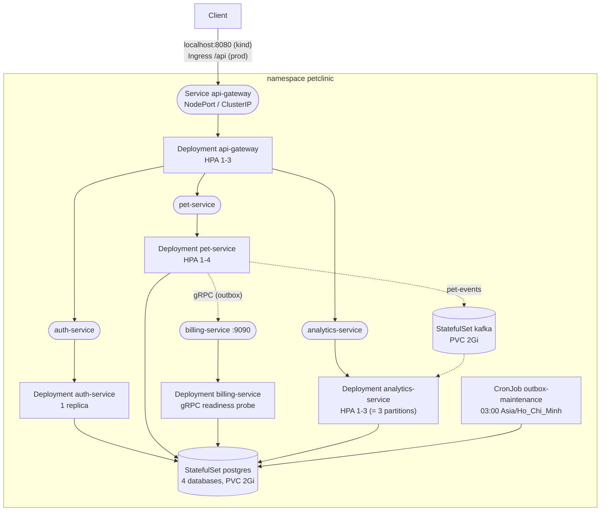

# Pet Clinic trên Kubernetes

Tài liệu học Kubernetes qua chính dự án này: mỗi tính năng Kubernetes được dùng đều có lý do gắn với một bài toán cụ thể của Pet Clinic (outbox, header danh tính, Kafka partition, JVM...), kèm file cấu hình và lệnh để tự thử.

Mọi thứ nằm trong [`k8s/`](../k8s). Docker Compose vẫn giữ nguyên: compose để dev nhanh, Kubernetes để học vận hành và để chạy test end-to-end trong CI.

---

## 1. Thay đổi trong lần này

| Nhóm | Thay đổi | File |
| --- | --- | --- |
| Code | Thêm `spring-boot-starter-actuator` cho cả 5 service; bật `/actuator/health/liveness` và `/readiness` | `*/pom.xml`, `*/src/main/resources/application.yml` |
| Code | `server.shutdown: graceful`: khi nhận SIGTERM thì ngừng nhận request mới, làm xong request đang chạy rồi mới thoát | `*/application.yml` |
| Code | pet-service và auth-service cho phép `/actuator/health/**` không cần đăng nhập (kubelet gọi probe không có header/token); mọi đường dẫn actuator khác vẫn 401 | `*/security/SecurityConfig.java`, test `AuthorizationIntegrationTest.kubernetesProbesAreOpenButNothingElseUnderActuatorIs` |
| Hạ tầng | Manifest Kubernetes viết bằng Kustomize: `base` + 2 overlay `local` (kind/minikube) và `prod` | `k8s/base`, `k8s/overlays` |
| Hạ tầng | PostgreSQL và Kafka (KRaft) chạy bằng StatefulSet + PersistentVolumeClaim | `k8s/base/postgres`, `k8s/base/kafka` |
| Hạ tầng | NetworkPolicy: chặn mọi kết nối vào, chỉ mở đúng các cạnh trong sơ đồ kiến trúc | `k8s/base/network-policies.yaml` |
| Hạ tầng | HorizontalPodAutoscaler cho gateway, pet-service, analytics-service | `k8s/base/autoscaling/hpa.yaml` |
| Tính năng mới | CronJob `outbox-maintenance`: xóa dòng outbox đã giao quá 7 ngày, báo động khi có dòng "chết" (đã thử 10 lần) | `k8s/base/jobs/` |
| Script | Dựng cluster kind, build và nạp image, deploy, smoke test end-to-end | `k8s/scripts/` |
| CI | Workflow mới: validate manifest bằng kubeconform, rồi deploy lên kind và chạy smoke test | `.github/workflows/ci-k8s.yml` |

Hai mục trong Roadmap của README được làm luôn nhờ Kubernetes: **test end-to-end xuyên service** (smoke test trên kind trong CI) và **job dọn bảng outbox + cảnh báo dòng kẹt** (CronJob).

---

## 2. Từ Docker Compose sang Kubernetes

Nếu đã hiểu `docker-compose.yml` của dự án thì đã hiểu được một nửa. Bảng ánh xạ:

| Docker Compose | Kubernetes | Ở dự án này |
| --- | --- | --- |
| một `service:` chạy app | **Deployment** (quản lý ReplicaSet, ReplicaSet quản lý Pod) | 5 service trong `k8s/base/apps/` |
| `postgres-db` có volume | **StatefulSet** + **PersistentVolumeClaim** | `postgres`, `kafka` |
| tên service làm DNS (`kafka:9092`) | **Service** + DNS của cluster (`kafka.petclinic.svc.cluster.local`) | cùng tên với compose, trừ `postgres-db` → `postgres` |
| `ports: "8080:8080"` | Service kiểu **NodePort** / **LoadBalancer**, hoặc **Ingress** | NodePort 30080 (local), Ingress (prod) |
| `ports: "127.0.0.1:8082:8082"` (chỉ máy local) | Service **ClusterIP** (chỉ trong cluster) + **NetworkPolicy** | mọi service trừ gateway |
| `environment:` | **ConfigMap** (thường) và **Secret** (bí mật) | `config.env`, `secrets.env` |
| `.env` | `secretGenerator` của Kustomize, hoặc `kubectl create secret` | overlay `local` / `prod` |
| `healthcheck:` | **startupProbe**, **livenessProbe**, **readinessProbe** | actuator, gRPC probe, `pg_isready` |
| `depends_on: condition: service_healthy` | không có; dùng **initContainers** chờ phụ thuộc | `wait-for-postgres`, `wait-for-kafka` |
| `restart: unless-stopped` | mặc định: kubelet tự khởi động lại container, ReplicaSet tạo lại Pod | |
| `logging: max-size` | log stdout do node xoay vòng; gom bằng Loki/ELK | |
| `docker-compose.yml` vs `docker-compose.prod.yml` | **Kustomize overlays** `local` vs `prod` | `k8s/overlays/` |
| (không có) | **HPA**, **PodDisruptionBudget**, **CronJob**, **SecurityContext** | phần 6 |

---

## 3. Kiến trúc trên cluster



Mỗi mũi tên là một kết nối mà NetworkPolicy cho phép; kết nối nào không có trong hình đều bị chặn.

---

## 4. Cấu trúc thư mục `k8s/`

```
k8s/
├── base/                          # dùng chung mọi môi trường
│   ├── kustomization.yaml         # danh sách resource, namespace, generator
│   ├── namespace.yaml
│   ├── config.env                 # -> ConfigMap petclinic-config
│   ├── apps/                      # Deployment + Service cho 5 service
│   ├── postgres/                  # StatefulSet + headless Service + init.sql
│   ├── kafka/                     # StatefulSet KRaft + headless Service
│   ├── autoscaling/hpa.yaml
│   ├── network-policies.yaml
│   └── jobs/                      # CronJob outbox-maintenance + script
├── overlays/
│   ├── local/                     # kind/minikube: image :dev, Secret sinh từ secrets.env, NodePort
│   └── prod/                      # image từ registry, minReplicas 2, PDB, Ingress, spread
├── kind/cluster.yaml              # cluster 1 node, map localhost:8080 -> NodePort 30080
└── scripts/                       # build-images, kind-up, smoke-test, kind-down
```

Xem nhanh Kustomize sinh ra gì: `kubectl kustomize k8s/overlays/local | less`.

---

## 5. Chạy trên máy

**Cần:** Docker, [kind](https://kind.sigs.k8s.io/) 0.24 trở lên, `kubectl`, `openssl`. Trên Windows chạy script bằng Git Bash hoặc WSL. Docker cần khoảng 5 GB RAM (5 JVM 512 MiB, Kafka 1 GiB, Postgres).

```bash
k8s/scripts/kind-up.sh        # tạo cluster, build 5 image, nạp vào kind, deploy, chờ Ready
k8s/scripts/smoke-test.sh     # kiểm tra end-to-end (phần 8)
k8s/scripts/kind-down.sh      # xóa cluster và toàn bộ dữ liệu
```

Gateway ở `http://localhost:8080` như khi chạy compose, nên các lệnh `curl` trong README dùng được nguyên văn. Mật khẩu admin nằm trong `k8s/overlays/local/secrets.env` (file này do script sinh ngẫu nhiên và bị git ignore).

**Dùng minikube thay kind:**

```bash
minikube start --cpus 4 --memory 6g --cni calico     # calico để NetworkPolicy có hiệu lực
minikube addons enable metrics-server                # cho HPA
k8s/scripts/build-images.sh dev
for s in api-gateway auth-service pet-service billing-service analytics-service; do
  minikube image load petclinic/$s:dev
done
cp k8s/overlays/local/secrets.env.example k8s/overlays/local/secrets.env   # rồi điền giá trị
kubectl apply -k k8s/overlays/local
minikube service api-gateway -n petclinic --url      # lấy URL của gateway
```

**Các lệnh hay dùng:**

```bash
kubectl -n petclinic get pods -w                         # xem pod lên dần
kubectl -n petclinic logs deploy/pet-service -f          # log (một pod của deployment)
kubectl -n petclinic logs -l app.kubernetes.io/name=pet-service --prefix   # log mọi pod
kubectl -n petclinic describe pod <tên-pod>              # Events: vì sao pod không lên
kubectl -n petclinic exec -it postgres-0 -- psql -U petclinic_user -d pet_clinic_pets
kubectl -n petclinic port-forward svc/billing-service 9090   # gọi thử một service nội bộ
kubectl -n petclinic get events --sort-by=.lastTimestamp
```

---

## 6. Các tính năng Kubernetes được dùng, và vì sao

### 6.1 Namespace và label

Mọi thứ nằm trong namespace `petclinic`, nên `kubectl delete namespace petclinic` dọn sạch (kể cả PVC). Mỗi object có `app.kubernetes.io/name` (dùng cho selector của Service, NetworkPolicy, HPA) và `app.kubernetes.io/part-of: petclinic` (Kustomize gắn tự động).

Selector của Deployment là bất biến sau khi tạo, nên Kustomize được cấu hình `includeSelectors: false`: thêm label chung không làm đổi selector.

### 6.2 Deployment và rolling update

```yaml
strategy:
  rollingUpdate:
    maxSurge: 1          # tạo thêm 1 pod mới trước
    maxUnavailable: 0    # chỉ xóa pod cũ khi pod mới đã Ready
```

Khi đổi image hoặc config, Kubernetes thay pod từng cái một và chỉ chuyển traffic sang pod mới khi readiness probe báo Ready. Có lỗi thì `kubectl rollout undo deployment/pet-service` quay về bản trước (`revisionHistoryLimit: 5` giữ 5 bản).

Rolling update nghĩa là **bản cũ và bản mới chạy song song** trong vài chục giây. Migration Flyway vì vậy phải tương thích ngược (expand → migrate → contract), đúng như câu Q28 trong tài liệu phỏng vấn.

### 6.3 Service và DNS

| Loại | Dùng cho | Ở đây |
| --- | --- | --- |
| ClusterIP | IP ảo, cân bằng tải giữa các pod, chỉ truy cập được trong cluster | auth, pet, billing, analytics, gateway (base) |
| Headless (`clusterIP: None`) | Không có IP ảo; DNS trả thẳng IP pod; mỗi pod có tên riêng `kafka-0.kafka` | `postgres`, `kafka` (bắt buộc cho StatefulSet) |
| NodePort | Mở một cổng trên node | gateway ở overlay `local` (30080) |
| Ingress | Một cửa HTTP(S) cho cả cluster, TLS, định tuyến theo host/path | overlay `prod`, chỉ `/api` vào gateway |

Tên Service là DNS: `http://pet-service:8082` từ trong namespace, `pet-service.petclinic.svc.cluster.local` từ namespace khác. Vì giữ đúng tên như compose nên code không phải đổi gì.

**gRPC và Service:** gRPC giữ một kết nối HTTP/2 lâu dài, ClusterIP cân bằng theo kết nối chứ không theo lời gọi; có 3 pod billing thì mọi lời gọi vẫn dồn vào 1 pod. Cách sửa khi cần scale billing: Service headless + client dùng `dns:///billing-service:9090` với `round_robin`, hoặc service mesh (Linkerd/Istio). Hiện billing chỉ 1 replica nên chưa cần.

### 6.4 ConfigMap và Secret

- `config.env` → ConfigMap `petclinic-config`: host DB, địa chỉ Kafka, URL các service, tham số JVM.
- `secrets.env` → Secret `petclinic-secrets`: mật khẩu DB, `JWT_SECRET`, tài khoản admin đầu tiên.

Ba điểm đáng nói:

1. **Hash trong tên.** `configMapGenerator`/`secretGenerator` sinh tên kiểu `petclinic-config-7g2f9m8k4t` và Kustomize sửa mọi chỗ tham chiếu. Đổi một giá trị → đổi tên → đổi pod template → Deployment tự rolling update. ConfigMap thường (không hash) thì pod đang chạy giữ giá trị cũ cho tới khi bị restart.
2. **Ít quyền nhất.** Secret được gắn từng key bằng `secretKeyRef`, không dùng `envFrom`: chỉ auth-service và gateway có `JWT_SECRET`; billing hay analytics không đọc được nó.
3. **Secret chỉ là base64, không phải mã hóa.** Ai có quyền `get secret` là đọc được. Production cần bật mã hóa etcd, RBAC chặt, và quản lý bằng External Secrets / Sealed Secrets thay vì để file. Vì thế overlay `prod` không sinh Secret từ file mà yêu cầu tạo riêng.

Biến `$(VAR)` trong `env` được Kubernetes thay bằng biến định nghĩa trước đó, kể cả từ `envFrom`:
`SPRING_DATASOURCE_URL: jdbc:postgresql://$(DB_HOST):$(DB_PORT)/pet_clinic_pets`.

### 6.5 Probe: startup, liveness, readiness

| Probe | Câu hỏi | Thất bại thì | Ở đây |
| --- | --- | --- | --- |
| startupProbe | App khởi động xong chưa? | chờ tiếp, tối đa 36 × 5 s = 3 phút, sau đó restart | `/actuator/health/liveness` |
| livenessProbe | Process còn sống hay đã treo? | **restart container** | `/actuator/health/liveness` |
| readinessProbe | Có nên nhận traffic không? | **gỡ pod khỏi Service**, không restart | `/actuator/health/readiness`; billing dùng **gRPC probe** |

- Không có startupProbe thì phải đặt `initialDelaySeconds` lớn cho liveness; đặt nhỏ quá thì JVM khởi động chậm (Flyway, Kafka admin) bị giết giữa chừng và rơi vào CrashLoopBackOff.
- **Liveness không được kiểm tra phụ thuộc bên ngoài.** Nếu liveness gọi DB thì DB chậm 30 giây làm mọi pod bị restart cùng lúc, biến sự cố nhỏ thành sập toàn hệ thống. Group `liveness` của Spring Boot chỉ chứa trạng thái nội bộ của ứng dụng, nên đúng nguyên tắc này.
- billing-service dùng probe gRPC gốc của Kubernetes (`grpc: port: 9090`, cần 1.27+): kubelet gọi `grpc.health.v1.Health/Check` do grpc-spring-boot-starter đăng ký. Pod Ready nghĩa là chính server gRPC trả lời được, thứ pet-service thật sự cần.
- Postgres dùng `exec: pg_isready`, Kafka dùng `tcpSocket`.

Probe đến từ kubelet nên không có header gateway; vì vậy pet-service và auth-service mở `/actuator/health/**`. Gateway không có route nào tới `/actuator` của service phía sau, và chỉ endpoint `health` được bật, không kèm chi tiết.

### 6.6 Tắt êm (graceful shutdown)

Khi xóa một pod (rolling update, scale down, drain node), hai việc xảy ra **song song**: pod bị gỡ khỏi endpoint của Service, và container nhận SIGTERM. Nếu Spring dừng ngay, các request vẫn đang được định tuyến tới pod đó sẽ lỗi.

```
t=0s   pod bị đánh dấu xóa: gỡ khỏi endpoint  |  preStop: sleep 5
t=5s   kube-proxy/gateway đã ngừng gửi tới    |  SIGTERM -> Spring graceful: từ chối request mới,
                                              |  chờ request đang chạy (tối đa 20 s)
t≤25s  JVM thoát
t=40s  terminationGracePeriodSeconds: nếu còn sống thì SIGKILL
```

Ba thứ phải khớp nhau: `preStop sleep 5` + `SPRING_LIFECYCLE_TIMEOUT_PER_SHUTDOWN_PHASE=20s` < `terminationGracePeriodSeconds: 40`. Với OutboxRelay, transaction đang chạy hoặc commit xong, hoặc rollback và dòng outbox được relay khác lấy lại, nên không mất sự kiện.

### 6.7 Tài nguyên và JVM

```yaml
resources:
  requests: { cpu: 100m, memory: 512Mi }
  limits:   { memory: 512Mi }
```

- **requests** dùng để xếp pod lên node và là mẫu số của HPA (70 % của 100m).
- **memory limit = request:** vượt limit thì container bị **OOMKilled** (exit code 137). JVM tự tính heap từ limit của container; `-XX:MaxRAMPercentage=60` cho heap khoảng 300 MiB, phần còn lại cho metaspace, stack, direct buffer. Để 100 % thì heap lấp đầy limit và pod bị kill dù Java không báo OutOfMemoryError.
- **Không đặt CPU limit:** CPU limit làm JVM bị throttle (đặc biệt lúc khởi động và lúc GC), latency tăng vọt. Request đã đảm bảo phần chia công bằng khi node bận.
- `-XX:+ExitOnOutOfMemoryError`: hết heap thì thoát luôn để Kubernetes restart, thay vì JVM sống dở chết dở.

### 6.8 StatefulSet và volume (Postgres, Kafka)

Deployment coi các pod như nhau và thay được cho nhau; database thì không. StatefulSet cho:

- tên pod cố định (`postgres-0`, `kafka-0`) và DNS riêng cho từng pod;
- mỗi pod một PVC riêng từ `volumeClaimTemplates` (`data-postgres-0`). Xóa pod thì pod mới gắn lại đúng PVC đó; dữ liệu chỉ mất khi xóa PVC.

Những bẫy đã được xử lý sẵn trong manifest:

| Bẫy | Biểu hiện | Cách xử lý |
| --- | --- | --- |
| Kubernetes tự tạo biến `KAFKA_PORT=tcp://10.x.x.x:9092` cho Service tên `kafka` (service links kiểu docker) | Image Confluent biến mọi `KAFKA_*` thành config và dừng ngay khi gặp `port` | `enableServiceLinks: false` ở mọi pod |
| Kafka trả cho client địa chỉ **advertised** | Advertise `localhost` hay IP pod thì client không kết nối lại được, hoặc broker không tự gọi được chính nó lúc khởi động | `PLAINTEXT://$(POD_NAME).kafka.$(POD_NAMESPACE).svc.cluster.local:9092` (Downward API) + `publishNotReadyAddresses: true` |
| Volume có sẵn thư mục `lost+found` | `initdb: directory not empty`, Postgres không lên | `PGDATA=/var/lib/postgresql/data/pgdata`; Kafka dùng thư mục con `kraft-logs` |
| Kafka chạy bằng user 1000 | Không ghi được vào volume | `fsGroup: 1000` |
| `init.sql` chỉ chạy khi volume trống | Thêm database mới vào script không có tác dụng với cluster cũ | Như compose: tạo tay bằng `kubectl exec postgres-0 -- psql ...` |

Production nên dùng database managed (RDS, Cloud SQL) hoặc operator (CloudNativePG, Strimzi cho Kafka): backup, failover, nâng cấp. Tự viết StatefulSet là để học.

### 6.9 Init container thay cho `depends_on`

Kubernetes không có thứ tự khởi động giữa các Deployment. pet-service mà lên trước Kafka thì admin client bỏ cuộc sau khoảng 30 giây và topic `pet-events` sau đó bị producer tự tạo với **1 partition thay vì 3** (mất khả năng chạy song song ở analytics). Init container chạy tuần tự và phải xong trước khi container chính bắt đầu:

```yaml
initContainers:
  - name: wait-for-kafka
    image: busybox:1.36
    command: ["sh", "-c", "until nc -z -w 2 kafka 9092; do sleep 2; done"]
```

Init container cũng dùng cho migration (chạy Flyway trước app), tải file cấu hình, chờ secret...

### 6.10 HorizontalPodAutoscaler

HPA đọc CPU từ metrics-server và chỉnh số replica: `replicas = ceil(hiện tại × CPU thực tế / CPU mục tiêu)`.

| HPA | min–max | Vì sao giới hạn đó |
| --- | --- | --- |
| api-gateway | 1–3 | stateless |
| pet-service | 1–4 | nhiều pod an toàn: mỗi pod có một OutboxRelay, `FOR UPDATE SKIP LOCKED` chia dòng outbox giữa các relay, không gửi trùng; Flyway giữ lock DB nên hai pod khởi động cùng lúc không migrate hai lần |
| analytics-service | 1–3 | `pet-events` có 3 partition; trong một consumer group mỗi partition chỉ thuộc một consumer, pod thứ 4 sẽ ngồi không |

auth-service và billing-service để cố định 1 replica: schema đang dùng `ddl-auto: update` và admin đầu tiên được tạo lúc khởi động, cả hai không được viết cho nhiều pod khởi động đồng thời.

Deployment có HPA **không khai báo `replicas`**: nếu có, mỗi lần `kubectl apply` sẽ đặt lại số replica, giành quyền với HPA. `behavior.scaleUp.stabilizationWindowSeconds: 60` tránh scale chỉ vì JVM ngốn CPU lúc khởi động.

### 6.11 NetworkPolicy: lý do an ninh quan trọng nhất

pet-service tin header `X-User-Id`/`X-User-Role` vì gateway đặt chúng. Service ClusterIP không ra được Internet, nhưng **mọi pod trong cluster** đều gọi được `pet-service:8082`. Một pod bị chiếm (hay một pod debug) chỉ cần gửi `X-User-Role: ADMIN`.

`network-policies.yaml` chặn toàn bộ kết nối vào namespace (`default-deny-ingress`), rồi chỉ mở:

| Đích | Nguồn được phép | Cổng |
| --- | --- | --- |
| api-gateway | mọi nơi | 8080 |
| auth / pet / analytics | api-gateway | 8081 / 8082 / 8084 |
| billing-service | pet-service | 9090 |
| postgres | auth, pet, billing, analytics, outbox-maintenance | 5432 |
| kafka | pet-service, analytics-service | 9092 |

Thử tấn công (phần 7.4). NetworkPolicy chỉ có hiệu lực khi CNI hỗ trợ: kind 0.24+ (kindnet), Calico, Cilium. Flannel đơn thuần thì bỏ qua âm thầm, nên smoke test có bước kiểm tra chính điều này. Mức cao hơn là mTLS giữa các service (service mesh) để danh tính dựa trên chứng chỉ, không dựa trên IP.

### 6.12 CronJob: bảo trì bảng outbox

Hai việc còn thiếu trong tài liệu phỏng vấn (Q9, Q10) giờ là một CronJob chạy 03:00 giờ Việt Nam mỗi ngày ([`outbox-maintenance.sh`](../k8s/base/jobs/outbox-maintenance.sh)):

1. Xóa dòng đã giao (`processed_at` có giá trị) cũ hơn 7 ngày: relay chỉ đọc dòng chưa giao, nhưng bảng và index vẫn phình.
2. Tìm dòng "chết": chưa giao và đã thử 10 lần (`OutboxRelay.MAX_ATTEMPTS`), relay sẽ không thử nữa. Có thì in ra `id`, `event_type`, `last_error` và **thoát mã 1**: Job bị đánh dấu Failed. `kubectl get jobs` thấy ngay, và Prometheus/kube-state-metrics có thể cảnh báo trên `kube_job_status_failed`.

Thiết lập đáng chú ý: `timeZone: Asia/Ho_Chi_Minh` (không thì là giờ UTC của node), `concurrencyPolicy: Forbid`, `backoffLimit: 0` (một báo động không được retry tới khi im lặng), `failedJobsHistoryLimit: 5`, image `postgres:15-alpine` chỉ để có `psql`.

### 6.13 SecurityContext

Mọi pod ứng dụng chạy với:

```yaml
runAsNonRoot: true, runAsUser: 10001        # không chạy root
readOnlyRootFilesystem: true                # không ghi được vào image; /tmp là emptyDir
allowPrivilegeEscalation: false
capabilities: { drop: ["ALL"] }
seccompProfile: { type: RuntimeDefault }
```

Kẻ tấn công chiếm được process Java cũng không cài thêm công cụ hay sửa file trong container. Cái giá: Tomcat và Netty cần thư mục tạm có quyền ghi, nên `/tmp` được gắn `emptyDir`. Các thiết lập này đáp ứng chuẩn Pod Security "restricted" (trừ Postgres, cần root để `chown` thư mục dữ liệu).

### 6.14 Kustomize, overlay `prod`, PodDisruptionBudget, Ingress

`base` mô tả ứng dụng; overlay chỉ ghi phần khác:

| | `local` | `prod` |
| --- | --- | --- |
| Image | `petclinic/*:dev` build trên máy, nạp vào kind | `ghcr.io/...:<tag cố định>` |
| Secret | sinh từ `secrets.env` | tạo riêng (`kubectl create secret`, External Secrets) |
| Gateway | NodePort 30080 | Ingress `api.petclinic.example.com`, TLS qua cert-manager |
| Replica tối thiểu | 1 | 2 cho gateway và pet-service |
| PodDisruptionBudget | không | `minAvailable: 1`: `kubectl drain` chờ thay vì gỡ pod Ready cuối cùng |
| Phân bố | | `topologySpreadConstraints` theo hostname: 2 pod không nằm chung một node nếu tránh được |
| Volume | 2 Gi | 20 Gi |

PDB chỉ bảo vệ khỏi gián đoạn **chủ động** (drain, autoscaler bớt node). Node chết hay pod crash thì phải nhờ số replica.

---

## 7. Bài thực hành

Chạy sau `kind-up.sh`. Tất cả trong namespace `petclinic` (`alias k='kubectl -n petclinic'`).

### 7.1 Tự hồi phục

```bash
k delete pod -l app.kubernetes.io/name=pet-service
k get pods -w            # ReplicaSet tạo pod mới ngay; Ready sau khi readiness probe qua
k delete pod postgres-0  # pod mới cùng tên, gắn lại PVC data-postgres-0: dữ liệu còn nguyên
```

### 7.2 Rolling update và rollback

```bash
k set env deploy/pet-service DEMO_VERSION=2      # đổi pod template -> rollout
k rollout status deploy/pet-service
k rollout history deploy/pet-service
k rollout undo deploy/pet-service
```

Trong lúc rollout, chạy vòng `curl` vào gateway: không request nào lỗi (maxUnavailable 0, readiness, preStop + graceful shutdown).

### 7.3 Nhiều pet-service cùng một bảng outbox

```bash
k patch hpa pet-service -p '{"spec":{"minReplicas":3}}'   # scale qua HPA; `kubectl scale` sẽ bị HPA ghi đè
k get pods -l app.kubernetes.io/name=pet-service
# tạo vài chục owner/pet qua gateway (lệnh trong README), rồi:
k exec postgres-0 -- psql -U petclinic_user -d pet_clinic_pets -c \
  "SELECT count(*) FILTER (WHERE processed_at IS NULL) AS pending, count(*) AS total FROM outbox_events"
```

Ba relay chia nhau các dòng nhờ `SKIP LOCKED`. Lưu ý trung thực: nếu có gửi trùng thì bên nhận idempotent cũng che đi, nên bằng chứng "không gửi trùng" nằm ở test của relay, còn bài này cho thấy nhiều relay chạy cùng nhau không kẹt và không mất dòng.

### 7.4 NetworkPolicy chặn header giả

```bash
# pod bất kỳ giả làm ADMIN: bị chặn (timeout)
k run attacker --rm -it --restart=Never --image=curlimages/curl -- \
  curl -m 5 -H 'X-User-Id: 1' -H 'X-User-Role: ADMIN' http://pet-service:8082/api/v1/owners?phone=0900000000
# cùng lệnh nhưng pod mang label của gateway: qua được (chứng minh là policy chặn, không phải mạng hỏng)
k run fake-gw --rm -it --restart=Never --labels=app.kubernetes.io/name=api-gateway --image=curlimages/curl -- \
  curl -m 5 -H 'X-User-Id: 1' -H 'X-User-Role: ADMIN' http://pet-service:8082/api/v1/owners?phone=0900000000
```

Lệnh thứ hai cho thấy giới hạn: NetworkPolicy dựa trên label, ai tạo được pod với label đó trong namespace là qua. Phải kết hợp RBAC (ai được tạo pod) và mTLS nếu cần chặt hơn.

### 7.5 Billing chết, outbox chờ, CronJob báo động

```bash
k scale deploy/billing-service --replicas=0       # billing chết
# tạo một owner qua gateway: vẫn 201, dòng outbox chờ, relay retry với backoff
k logs deploy/pet-service | grep "Outbox event"   # attempt 1/10, 2/10...
# giả lập đã hết lượt thử để thấy báo động:
k exec postgres-0 -- psql -U petclinic_user -d pet_clinic_pets -c \
  "UPDATE outbox_events SET attempts = 10 WHERE processed_at IS NULL"
k create job --from=cronjob/outbox-maintenance outbox-demo
k logs job/outbox-demo          # ALERT: ... dòng chết; job Failed
k get jobs
# sửa nguyên nhân rồi replay:
k scale deploy/billing-service --replicas=1
k exec postgres-0 -- psql -U petclinic_user -d pet_clinic_pets -c \
  "UPDATE outbox_events SET attempts = 0, next_attempt_at = NOW() WHERE processed_at IS NULL"
```

### 7.6 HPA

```bash
# kind chưa có metrics-server:
kubectl apply -f https://github.com/kubernetes-sigs/metrics-server/releases/download/v0.7.2/components.yaml
kubectl -n kube-system patch deploy metrics-server --type=json \
  -p '[{"op":"add","path":"/spec/template/spec/containers/0/args/-","value":"--kubelet-insecure-tls"}]'
k get hpa -w
# tạo tải lên gateway (ví dụ: hey -z 2m -c 50 -H "Authorization: Bearer $TOKEN" http://localhost:8080/api/v1/owners/me)
```

---

## 8. Smoke test và CI

[`k8s/scripts/smoke-test.sh`](../k8s/scripts/smoke-test.sh) chạy trên cluster thật, qua gateway thật:

1. đăng ký, đăng nhập, tạo owner và pet;
2. khách khác nhận 403 trên pet đó;
3. analytics đếm được pet (pet-service → outbox → Kafka → analytics-service);
4. outbox rỗng và billing có tài khoản cho owner (outbox → gRPC → billing-service);
5. pod lạ không gọi được pet-service, pod mang label gateway thì gọi được;
6. CronJob `outbox-maintenance` chạy thành công.

[`.github/workflows/ci-k8s.yml`](../.github/workflows/ci-k8s.yml) có hai job:

- **validate**: render cả hai overlay bằng `kubectl kustomize` và kiểm từng object với schema Kubernetes 1.31 bằng `kubeconform -strict` (sai tên field, sai kiểu là đỏ ngay, mất vài giây);
- **e2e**: dựng kind trong runner, build 5 image, deploy overlay `local`, chạy smoke test; lỗi thì in events, `describe` và log mọi pod.

Đây là test xuyên service mà README trước đây ghi là còn thiếu.

---

## 9. Gỡ lỗi nhanh

| Trạng thái pod | Thường là do | Xem |
| --- | --- | --- |
| `Pending` | không đủ CPU/RAM trên node, PVC chưa bind | `k describe pod`, phần Events |
| `ErrImagePull` / `ImagePullBackOff` | quên `kind load docker-image`, sai tag | `k describe pod` |
| `Init:0/2` lâu | Postgres/Kafka chưa lên, hoặc NetworkPolicy chặn | `k logs <pod> -c wait-for-kafka` |
| `CreateContainerConfigError` | thiếu Secret/ConfigMap hoặc key | `k describe pod` |
| `CrashLoopBackOff` | app lỗi khi khởi động (sai JWT_SECRET, DB...) | `k logs <pod> --previous` |
| `OOMKilled` (exit 137) | heap + phần ngoài heap vượt memory limit | giảm `MaxRAMPercentage` hoặc tăng limit |
| Running nhưng 0/1 Ready | readiness probe thất bại | `k describe pod`, `k logs` |
| Script `.sh` báo `$'\r': command not found` | file bị CRLF trên Windows | `.gitattributes` đã ép LF cho `*.sh` và `k8s/**`; checkout lại |

---

## 10. Còn thiếu để lên production thật

- Database và Kafka managed hoặc qua operator (backup, failover); Kafka 3 broker, replication factor 3, `min.insync.replicas=2` để `acks=all` có ý nghĩa.
- Pipeline đẩy image lên registry (GHCR) với tag là git SHA và cập nhật overlay `prod` (hoặc GitOps với Argo CD/Flux).
- Quản lý secret: External Secrets Operator hoặc Sealed Secrets; mã hóa etcd.
- Quan sát: Prometheus + Grafana (metric RED, consumer lag, `kube_job_status_failed`), OpenTelemetry tracing, gom log.
- Cân bằng tải gRPC theo lời gọi khi scale billing; mTLS giữa service (service mesh).
- Migration Flyway tách thành Job/init container riêng thay vì chạy lúc app khởi động.

---

## 11. Câu hỏi phỏng vấn về phần Kubernetes

**K1. Đã có Docker Compose, vì sao thêm Kubernetes?**
Compose chạy mọi thứ trên một máy và chỉ biết restart container. Kubernetes thêm những thứ hệ microservices cần khi chạy thật: tự thay pod hỏng, rolling update không downtime, autoscale, tách cấu hình và bí mật, chặn mạng giữa các service, job định kỳ. Em dùng nó để học vận hành và để có test end-to-end xuyên service trong CI; với quy mô phòng khám thì một VM với compose vẫn đủ.

**K2. Liveness, readiness và startup probe khác nhau thế nào? Đặt sai thì sao?**
Liveness thất bại thì restart, readiness thất bại thì chỉ ngừng nhận traffic, startup giữ hai cái kia lại cho tới khi app khởi động xong. Sai kinh điển là cho liveness kiểm tra DB: DB chậm làm mọi pod restart cùng lúc. Em dùng group liveness/readiness của Spring Boot (chỉ trạng thái nội bộ) và startupProbe 3 phút cho JVM; billing dùng gRPC probe để Ready nghĩa là server gRPC trả lời được.

**K3. Làm sao rolling update không làm rớt request?**
`maxUnavailable: 0` để luôn đủ pod Ready; readiness để chỉ chuyển traffic khi pod mới sẵn sàng; khi gỡ pod cũ, `preStop: sleep 5` chờ endpoint được cập nhật, rồi `server.shutdown: graceful` làm xong request đang chạy, tất cả trong `terminationGracePeriodSeconds`. Migration DB phải tương thích ngược vì hai phiên bản chạy song song.

**K4. Scale pet-service lên 3 pod có an toàn không?**
Có, và đó là lý do outbox dùng `FOR UPDATE SKIP LOCKED`: ba relay lấy ba nhóm dòng khác nhau. Flyway giữ lock DB nên chỉ một pod migrate. Bên nhận idempotent nên lỡ gửi lại vẫn đúng. auth-service thì em để 1 replica vì `ddl-auto: update` và tạo admin lúc khởi động không an toàn khi nhiều pod khởi động cùng lúc.

**K5. Vì sao analytics tối đa 3 replica?**
Topic có 3 partition; trong một consumer group mỗi partition chỉ giao cho một consumer, pod thứ 4 không nhận gì. Muốn song song hơn phải tăng partition (và chấp nhận đổi ánh xạ key → partition).

**K6. Service ClusterIP đã không ra Internet, sao còn cần NetworkPolicy?**
Vì pet-service tin header `X-User-Role` do gateway đặt. Mặc định mọi pod gọi được mọi pod, nên một pod bị chiếm là tự xưng ADMIN được. Em chặn toàn bộ rồi chỉ mở đúng các cạnh trong sơ đồ; smoke test kiểm tra cả pod lạ bị chặn lẫn pod gateway được qua. Giới hạn: policy dựa trên label, nên cần RBAC, và mTLS nếu muốn danh tính bằng chứng chỉ.

**K7. Secret của Kubernetes có an toàn không?**
Mặc định chỉ là base64 trong etcd. Cần mã hóa etcd, RBAC cho quyền đọc secret, và đưa secret từ Vault/cloud qua External Secrets. Trong dự án, Secret được gắn từng key nên chỉ auth-service và gateway có `JWT_SECRET`; overlay prod không chứa secret nào trong git.

**K8. StatefulSet khác Deployment ở đâu? Đưa Kafka vào Kubernetes khó chỗ nào?**
StatefulSet cho tên pod cố định, DNS riêng từng pod và PVC riêng đi theo pod. Kafka khó ở advertised listener: broker trả về địa chỉ để client kết nối lại, nên phải là DNS ổn định của từng pod (`kafka-0.kafka.petclinic.svc...`) và phải phân giải được trước khi pod Ready. Thêm một bẫy: Kubernetes tự sinh biến `KAFKA_PORT` cho Service tên kafka làm image Confluent dừng; em tắt `enableServiceLinks`. Production em sẽ dùng Strimzi.

**K9. JVM trong container cần chú ý gì?**
JVM tính heap theo memory limit của container; để mặc định hoặc quá cao thì phần ngoài heap đẩy tổng vượt limit và pod bị OOMKilled mà Java không báo lỗi. Em đặt request = limit = 512 MiB, `MaxRAMPercentage=60`, `ExitOnOutOfMemoryError`, và không đặt CPU limit để tránh throttle lúc khởi động và GC.

**K10. gRPC trên Kubernetes có vấn đề gì về cân bằng tải?**
gRPC dùng một kết nối HTTP/2 lâu dài; Service ClusterIP cân bằng theo kết nối nên mọi lời gọi dồn vào một pod. Cách sửa: headless Service + `round_robin` phía client, hoặc service mesh cân bằng ở tầng L7. Billing hiện một replica nên chưa cần, em ghi chú ngay trong manifest.

**K11. HPA hoạt động thế nào, có bẫy gì?**
HPA lấy CPU từ metrics-server, so với CPU request và tính số replica mới. Bẫy: Deployment vẫn khai `replicas` thì mỗi lần apply giành lại với HPA; JVM ngốn CPU lúc khởi động gây scale ảo, nên em đặt cửa sổ ổn định 60 giây. Không có request CPU thì HPA không tính được.

**K12. CronJob trong dự án làm gì? Vì sao `backoffLimit: 0`?**
Dọn dòng outbox đã giao quá 7 ngày và báo động khi có dòng hết lượt retry. Job thất bại chính là tín hiệu báo động, nên không retry (retry sẽ "chữa" báo động bằng cách lặp lại cùng kết quả hoặc che đi). `concurrencyPolicy: Forbid` để hai lần chạy không chồng nhau, `timeZone` để chạy theo giờ Việt Nam.

**K13. Em test phần Kubernetes thế nào?**
Hai tầng trong CI: `kubeconform` kiểm schema của mọi object sau khi Kustomize render cả hai overlay; rồi dựng kind trong runner, deploy, chạy smoke test đi qua gateway, gRPC, Kafka, hai database, NetworkPolicy và CronJob. Test này bắt được những lỗi mà unit/integration test không thấy: sai tên biến môi trường, sai DNS, probe sai đường dẫn, policy chặn nhầm.
