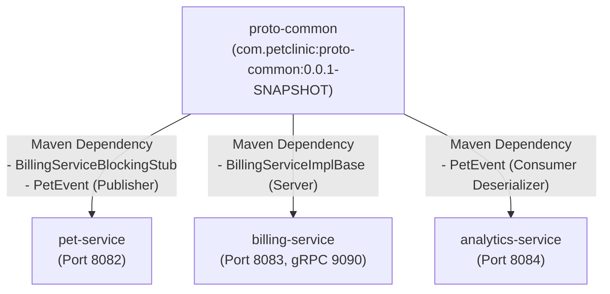

# 📜 Proto Common - Hợp Đồng Giao Thức Protobuf & gRPC Dùng Chung

`proto-common` là module thư viện dùng chung (Shared Contract Library) trong hệ thống microservices **Pet Clinic Management System**. Module này đóng vai trò là "nguồn chân lý duy nhất" (Single Source of Truth) định nghĩa toàn bộ hợp đồng truyền thông liên dịch vụ: bao gồm thông điệp nhị phân cho luồng sự kiện **Apache Kafka** và giao diện thủ tục từ xa cho **gRPC**.

---

## 📌 Mục Lục
1. [Tổng Quan Vai Trò & Công Nghệ](#-tổng-quan-vai-trò--công-nghệ)
2. [Chi Tiết Các Hợp Đồng Giao Thức (Contracts)](#-chi-tiết-các-hợp-đồng-giao-thức-contracts)
   - [1. `billing_service.proto` (gRPC Service Contract)](#1-billing_serviceproto-grpc-service-contract)
   - [2. `pet_events.proto` (Kafka Event Message Contract)](#2-pet_eventsproto-kafka-event-message-contract)
3. [Mô Hình Phụ Thuộc Trong Hệ Sinh Thái (Dependency Topology)](#-mô-hình-phụ-thuộc-trong-hệ-sinh-thái-dependency-topology)
4. [Cơ Chế Sinh Mã Nguồn (Code Generation Pipeline)](#-cơ-chế-sinh-mã-nguồn-code-generation-pipeline)
5. [Cấu Trúc Thư Mục](#-cấu-trúc-thư-mục)
6. [Hướng Dẫn Biên Dịch & Cài Đặt (Build Guide)](#-hướng-dẫn-biên-dịch--cài-đặt-build-guide)

---

## 🏛 Tổng Quan Vai Trò & Công Nghệ

- **Ngôn ngữ định nghĩa giao diện (IDL)**: **Protocol Buffers v3 (Proto3)**.
- **Trình biên dịch (Protoc)**: `com.google.protobuf:protoc:3.25.3`.
- **Plugin sinh mã gRPC**: `io.grpc:protoc-gen-grpc-java:1.62.2`.
- **Tự động nhận diện hệ điều hành**: `kr.motd.maven:os-maven-plugin:1.7.1` (Tự động tải binary protoc phù hợp cho Windows, Linux, macOS ARM/Intel).
- **Maven Plugin**: `org.xolstice.maven.plugins:protobuf-maven-plugin:0.6.1`.
- **Artifact Tọa độ**: `com.petclinic:proto-common:0.0.1-SNAPSHOT`.

---

## 📋 Chi Tiết Các Hợp Đồng Giao Thức (Contracts)

### 1. `billing_service.proto` (gRPC Service Contract)
- **Đường dẫn**: `src/main/proto/billing_service.proto`
- **Java Package sinh ra**: `com.petclinic.billing.grpc`
- **Mục đích**: Quy định giao thức giao tiếp RPC đồng bộ tốc độ cao giữa `pet-service` (Client) và `billing-service` (Server) khi mở tài khoản thanh toán cho khách hàng mới.

```protobuf
syntax = "proto3";
package com.petclinic.billing.grpc;

option java_multiple_files = true;
option java_package = "com.petclinic.billing.grpc";

service BillingService {
  rpc CreateBillingAccount (BillingRequest) returns (BillingResponse);
}

message BillingRequest {
  string customer_id = 1;
  string customer_name = 2;
  string email = 3;
}

message BillingResponse {
  string account_id = 1;
  string status = 2;
  string message = 3;
}
```

- **Các lớp Java sinh ra sau khi build**:
  - `BillingServiceGrpc`: Chứa `BillingServiceImplBase` (cho Server) và `BillingServiceBlockingStub` (cho Client).
  - `BillingRequest`: Message builder và parser cho tham số đầu vào.
  - `BillingResponse`: Message builder và parser cho kết quả trả về.

---

### 2. `pet_events.proto` (Kafka Event Message Contract)
- **Đường dẫn**: `src/main/proto/pet_events.proto`
- **Java Package sinh ra**: `com.petclinic.events`
- **Mục đích**: Định nghĩa cấu trúc chuẩn hóa cho các sự kiện vòng đời thú cưng được phát hành qua Apache Kafka topic `pet-events`, phục vụ tổng hợp phân tích tại `analytics-service`.

```protobuf
syntax = "proto3";
package com.petclinic.events;

option java_multiple_files = true;
option java_package = "com.petclinic.events";

message PetEvent {
  string event_id = 1;
  string event_type = 2; // e.g. PET_CREATED, APPOINTMENT_COMPLETED, VACCINATION_SCHEDULED
  int64 timestamp = 3;
  int64 pet_id = 4;
  string pet_name = 5;
  string species = 6;
  string breed = 7;
  int64 owner_id = 8;
  double amount = 9;
}
```

- **Các lớp Java sinh ra sau khi build**:
  - `PetEvent`: Chứa phương thức serialization `event.toByteArray()` và deserialization `PetEvent.parseFrom(byte[])`.
  - `PetEventOrBuilder`: Interface truy xuất getter các thuộc tính sự kiện.

---

## 🔗 Mô Hình Phụ Thuộc Trong Hệ Sinh Thái (Dependency Topology)



---

## ⚙️ Cơ Chế Sinh Mã Nguồn (Code Generation Pipeline)

Quá trình biên dịch của `proto-common` tự động diễn ra thông qua 2 bước chính trong Maven Lifecycle:
1. `goal: compile`: Biên dịch các tệp `.proto` thành các lớp Model Java chuẩn (`com.google.protobuf.GeneratedMessageV3`).
2. `goal: compile-custom`: Kích hoạt plugin `protoc-gen-grpc-java` để sinh ra các stub RPC cho client và server gRPC.

Các thư mục mã nguồn được tự động sinh ra sau khi chạy `mvn compile`:
- `target/generated-sources/protobuf/java/`: Chứa các lớp Message (`PetEvent`, `BillingRequest`, `BillingResponse`).
- `target/generated-sources/protobuf/grpc-java/`: Chứa các lớp dịch vụ gRPC (`BillingServiceGrpc`).

---

## 📂 Cấu Trúc Thư Mục

```
proto-common/
├── pom.xml                                   # Cấu hình os-maven-plugin và protobuf-maven-plugin
└── src/main/
    └── proto/
        ├── billing_service.proto             # Định nghĩa gRPC Service BillingService
        └── pet_events.proto                  # Định nghĩa Kafka Event Message PetEvent
```

---

## 🛠 Hướng Dẫn Biên Dịch & Cài Đặt (Build Guide)

Do các service khác (`pet-service`, `billing-service`, `analytics-service`) đều phụ thuộc trực tiếp vào artifact `proto-common`, **bắt buộc phải build module này đầu tiên** trước khi khởi chạy bất kỳ service nào khác trong môi trường máy cục bộ (Local Development).

### 1. Biên dịch và cài đặt vào Local Maven Repository
Tại thư mục gốc của repository:
```bash
cd proto-common
mvn clean install
```

Lệnh trên sẽ:
1. Tự động tải bản `protoc` phù hợp với hệ điều hành (Windows/macOS/Linux).
2. Biên dịch toàn bộ tệp `.proto`.
3. Đóng gói thành file `proto-common-0.0.1-SNAPSHOT.jar`.
4. Cài đặt vào thư mục `~/.m2/repository/com/petclinic/proto-common/0.0.1-SNAPSHOT/`.

### 2. Sử Dụng Trong Service Khác (`pom.xml`)
Để sử dụng các stubs và protobuf message trong một service mới, thêm dependency sau vào `pom.xml`:
```xml
<dependency>
    <groupId>com.petclinic</groupId>
    <artifactId>proto-common</artifactId>
    <version>0.0.1-SNAPSHOT</version>
</dependency>
```

### 3. Quy Trình Thay Đổi Hợp Đồng (Contract Evolution Best Practices)
Khi cần thêm trường hoặc phương thức mới vào file `.proto`:
1. **Backward Compatibility**: Không được đổi số tag (number tag: `= 1`, `= 2`...) của các trường đã tồn tại.
2. Thêm trường mới với số tag tiếp theo.
3. Chạy `mvn clean install` lại tại thư mục `proto-common`.
4. Cập nhật mã nguồn tại các service liên quan để xử lý thuộc tính mới.
