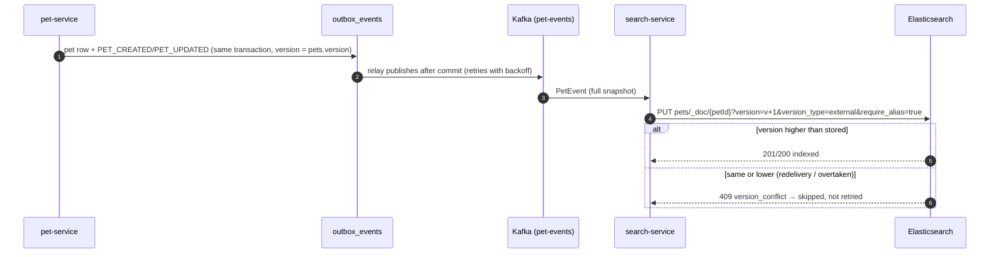

# search-service

Full-text search over pets, served from an **Elasticsearch read model** (CQRS). pet-service stays the
source of truth; this service only consumes `pet-events` from Kafka and answers queries. The index
can be dropped and rebuilt from the events.

| | |
| --- | --- |
| Port | `8085`, reached through the gateway at `/api/v1/search/**` |
| Kafka | topic `pet-events`, consumer group `search-indexer`, DLT `pet-events.search-indexer.DLT` |
| Elasticsearch | 8.13, alias `pets` → index `pets-v1` (mapping in `src/main/resources/elasticsearch/pets-v1.json`) |

## How the index stays correct



- **Snapshots, not deltas.** Every pet event carries the whole pet plus owner name, phone and
  account id, so one event is enough to write the document; no call back to pet-service.
- **External versioning.** `pets.version` is a JPA `@Version` column (Flyway V5), bumped on every
  update and published in the event. Elasticsearch only accepts a write with a higher version, so
  a duplicate or an older event arriving late can never overwrite newer data. That also makes
  the consumer idempotent without a `processed_events` table.
- **Alias + `require_alias`.** Reads and writes use the alias `pets`. If the alias is missing, the
  write fails (and is retried) instead of Elasticsearch auto-creating a `pets` index with a
  dynamic mapping. A new mapping can be built in `pets-v2` and the alias switched atomically.
- **Index created before consuming.** `PetIndexManager` creates index + alias in one request during
  context start-up, before the Kafka listeners start; a second replica racing it gets
  `resource_already_exists_exception`, which is ignored.
- **Errors.** Elasticsearch down → exponential backoff (1 s … 30 s, 6 retries), then the DLT.
  Corrupt payload → DLT at once (not retryable).

## Search API

`GET /api/v1/search/pets?q=&species=&page=0&size=20` (JWT required, through the gateway)

| Feature | How |
| --- | --- |
| Vietnamese without diacritics: `nguyen` finds `Nguyễn`, `muop` finds `Mướp` | custom analyzer `standard` + `lowercase` + `asciifolding` |
| Search as you type: `mi` finds `Milu` | `search_as_you_type` field + `multi_match` `bool_prefix` |
| Typos: `mlu` finds `Milu`, `penicilin` finds `penicillin` | `multi_match` `best_fields`, `fuzziness: AUTO`, `prefix_length: 1` |
| Reception desk phone lookup: `0912 345` | digits-only query → `prefix` on `ownerPhone` (keyword) |
| Facets | `terms` aggregation on `species`, in `speciesCounts` |
| Authorization | `CUSTOMER`: `ownerUserId` filter is always added, so hits, totals and facets only include their own pets. Staff see everything. Missing/invalid `X-User-*` headers → 401 |
| Limits | `size` ≤ 50, `(page+1)*size` ≤ 10 000 (`max_result_window`), `q` ≤ 100 chars → 400 otherwise |

```json
{
  "total": 1, "page": 0, "size": 20,
  "items": [
    { "petId": 12, "petName": "Milu", "species": "DOG", "breed": "Poodle", "allergies": "penicillin",
      "ownerId": 4, "ownerName": "Nguyễn Văn An", "ownerPhone": "0912345678", "score": 7.1 }
  ],
  "speciesCounts": { "DOG": 1 }
}
```

Results are **eventually consistent**: a new pet is searchable about a second after pet-service
commits it (outbox poll interval + Kafka + the 1 s index refresh).

## Run and test

```bash
(cd proto-common && mvn install -DskipTests)
docker compose up -d elasticsearch kafka
cd search-service && mvn spring-boot:run
```

`mvn verify`: unit tests (indexer versioning, consumer error classification, query building and
authorization filter, header parsing) and `PetSearchIntegrationTest` against a real Elasticsearch
8.13 started by Testcontainers. Without Docker, point it at a running node with
`ELASTICSEARCH_TEST_URL=http://localhost:9200`; with neither, the integration test is skipped.

## Known limits

- Events published before this service existed have no owner account id or version: those pets
  are found by staff, but not by their owner, until they are updated once.
- Not yet in the Kubernetes manifests (`k8s/`): it needs an Elasticsearch StatefulSet first.
