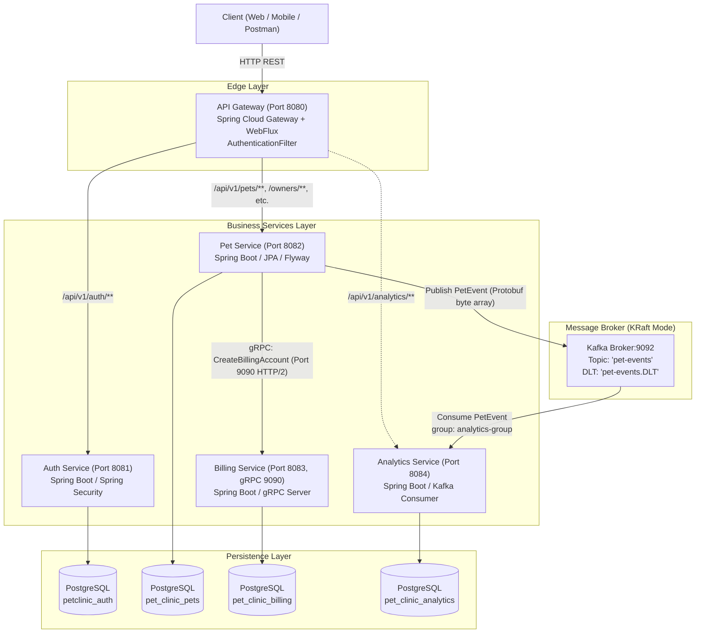
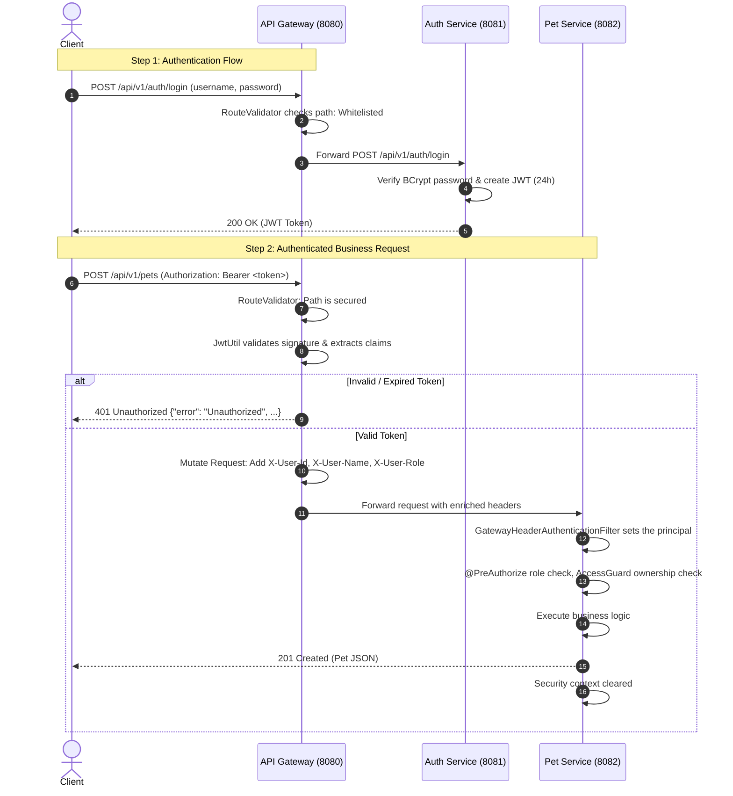
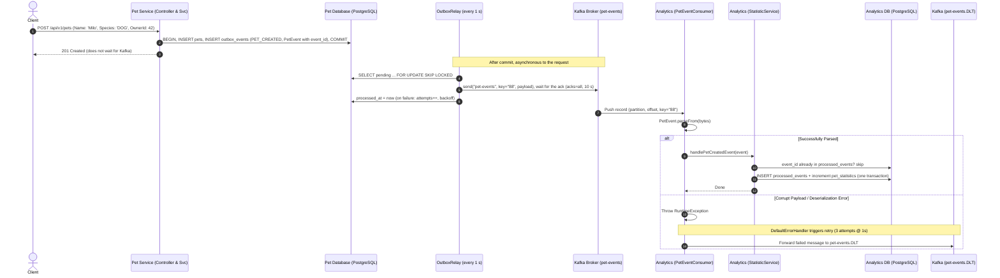
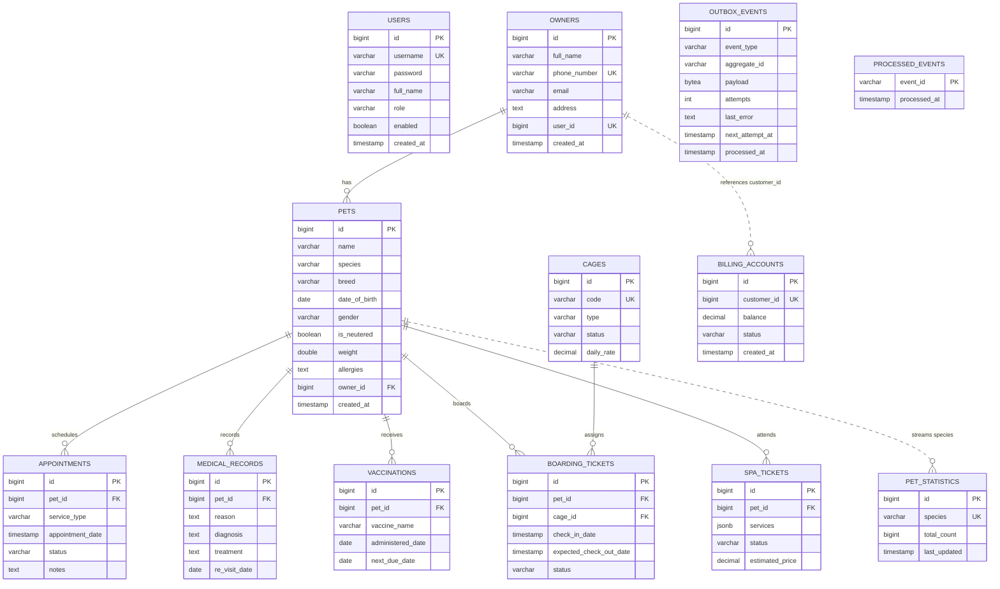

# Pet Clinic Management — System Architecture & Full Flow Documentation

This document provides an end-to-end technical breakdown of the **Pet Clinic Management** microservices ecosystem. It covers service responsibilities, API Gateway routing & security, synchronous inter-service communication via **gRPC**, asynchronous event streaming via **Apache Kafka (KRaft mode)** with **Protocol Buffers**, and database topologies.

---

## 1. High-Level Architecture Overview

The system is designed following a domain-driven microservices architecture:
* **API Gateway (`8080`)**: Central reactive reverse proxy with automated JWT validation and header enrichment.
* **Auth Service (`8081`)**: Identity and access management, issuing signed JWT tokens.
* **Pet Service (`8082`)**: Core domain service managing Owners, Pets, Medical Records, Vaccinations, Cages, Boarding, Spa, and Appointments.
* **Billing Service (`8083` HTTP, `9090` gRPC)**: Financial ledger and billing accounts management.
* **Analytics Service (`8084`)**: Event-driven real-time statistics aggregator.
* **Infrastructure**: Multi-database PostgreSQL 15, Kafka 7.6.1 in KRaft mode (no Zookeeper), and shared Protocol Buffers (`proto-common`).



---

## 2. Service Inventory & Network Topology

| Component | Port(s) | Technology Stack | Database / Storage | Key Responsibilities |
|---|---|---|---|---|
| [**api-gateway**](api-gateway) | `8080` (HTTP) | Spring Cloud Gateway (Reactive WebFlux), Java 17, JJWT | None | Single entry point, CORS management, JWT signature validation, header injection (`X-User-*`), request routing |
| [**auth-service**](auth-service) | `8081` (HTTP) | Spring Boot 3, Spring Security, Spring Data JPA, PostgreSQL Driver | `petclinic_auth` (PostgreSQL) | Customer self-registration (always `CUSTOMER`), credential verification, BCrypt hashing, JWT generation (`24h` expiration), admin-only staff accounts, bootstrap admin from the environment |
| [**pet-service**](pet-service) | `8082` (HTTP) | Spring Boot, Spring Security, Spring Data JPA, Flyway, `grpc-client-spring-boot-starter`, `spring-kafka` | `pet_clinic_pets` (PostgreSQL) | Clinic business logic: Pet, Owner, Appointment, Boarding, MedicalRecord, Spa; role and ownership authorization. Calls Billing over gRPC and publishes Kafka events, both through the transactional outbox |
| [**billing-service**](billing-service) | `8083` (HTTP)<br/>`9090` (gRPC) | Spring Boot, `grpc-server-spring-boot-starter`, Spring Data JPA | `pet_clinic_billing` (PostgreSQL) | Customer billing accounts, ledger balances, gRPC RPC implementation for instant account provisioning |
| [**analytics-service**](analytics-service) | `8084` (HTTP) | Spring Boot, `spring-kafka`, Spring Data JPA, PostgreSQL | `pet_clinic_analytics` (PostgreSQL) | Consumes Protobuf messages from Kafka, aggregates clinic metrics (e.g. pet counts per species), idempotent on `event_id` (`processed_events`), DLT error handling |
| [**proto-common**](proto-common) | N/A (Shared Lib) | Protobuf 3 compiler, `protobuf-java`, `grpc-protobuf`, `grpc-stub` | N/A | Language-neutral binary message and gRPC service contracts compiled to Java |
| **Kafka Broker** | `9092` (Client)<br/>`9093` (Controller) | Confluent Platform Kafka 7.6.1 (KRaft Mode) | Internal log segments | High-throughput, distributed event streaming without Zookeeper |
| **PostgreSQL** | `5432` | PostgreSQL 15 Alpine | Multi-database container | Persistent relational storage with schema migrations |

---

## 3. API Gateway & Security Flow

The API Gateway acts as the gatekeeper for all incoming external traffic.

### 3.1 Gateway Architecture Components
* **[RouteValidator.java](api-gateway/src/main/java/com/petclinic/apigateway/filter/RouteValidator.java)**:
  Defines an open-endpoints whitelist that bypasses token inspection (exact path match, not `contains`):
  ```java
  public static final Set<String> openApiEndpoints = Set.of(
      "/api/v1/auth/register",
      "/api/v1/auth/login"
  );
  ```
* **[AuthenticationFilter.java](api-gateway/src/main/java/com/petclinic/apigateway/filter/AuthenticationFilter.java)**:
  Inherits from `AbstractGatewayFilterFactory`. For any secured path:
  1. Checks for the presence of the `Authorization: Bearer <JWT>` header.
  2. Parses and verifies the HMAC-SHA256 signature using the shared secret key.
  0. **Strips any client-sent `X-User-*` headers** on every route (the filter is a `default-filter`), so identity can only come from a verified token.
  3. Extracts claims: `username = claims.getSubject()`, `role` and `userId` (tokens without `userId` are rejected → re-login).
  4. **Downstream Header Enrichment**: Injects custom headers into the request forwarded to internal microservices:
     * `X-User-Id: <userId>`
     * `X-User-Name: <username>`
     * `X-User-Role: <role>`
  5. If validation fails, immediately short-circuits and returns HTTP `401 Unauthorized` with a JSON payload: `{"error": "Unauthorized", "message": "..."}`.
* **Authorization in `pet-service`** (package `security`):
  * `GatewayHeaderAuthenticationFilter` turns `X-User-Id` and `X-User-Role` into a Spring Security principal (`CurrentUser`). Missing or malformed headers (non-numeric id, unknown role) leave the request anonymous, which gets `401`. Internal service ports are not published outside the Docker network.
  * Role rules: `@StaffOnly` (ADMIN, VET, RECEPTIONIST) and `@ClinicalStaffOnly` (ADMIN, VET) are `@PreAuthorize` meta-annotations on the controllers.
  * Ownership rules: `AccessGuard` checks that a customer only touches the owner profile linked to their account (`owners.user_id`, migration V4) and that owner's pets and appointments. Staff pass. Violations return `403`.
  * The security context is cleared after every request, so nothing leaks between pooled threads.



---

## 4. Synchronous Inter-Service Communication via gRPC

When a new pet owner is registered, the system creates a corresponding financial billing account via gRPC. The call is made by the outbox relay **after** the owner row commits (see 4.4), never inside the request transaction.

### 4.1 Protocol Contract (`billing_service.proto`)
Located in [proto-common/.../billing_service.proto](proto-common/src/main/proto/billing_service.proto):
```protobuf
syntax = "proto3";
package com.petclinic.billing.grpc;

option java_multiple_files = true;
option java_package = "com.petclinic.billing.grpc";

service BillingService {
  rpc CreateBillingAccount (BillingRequest) returns (BillingResponse);
}

message BillingRequest {
  string customer_id = 1;
  string customer_name = 2;
  string email = 3;
}

message BillingResponse {
  string account_id = 1;
  string status = 2;
  string message = 3;
}
```

### 4.2 Client Implementation (`pet-service`)
* Configured in [application.yml](pet-service/src/main/resources/application.yml):
  ```yaml
  grpc:
    client:
      billing-service:
        address: 'static://billing-service:9090'
        negotiation-type: plaintext
  ```
* Implemented in [BillingClientService.java](pet-service/src/main/java/com/petclinic/petservice/service/BillingClientService.java):
  * Uses `@GrpcClient("billing-service")` to inject `BillingServiceBlockingStub`, with a 5 s deadline per call.
  * Called only by `OutboxRelay` after the owner has committed (see 4.4); a `StatusRuntimeException` is rethrown so the relay retries the row with backoff.

### 4.3 Server Implementation (`billing-service`)
* Configured in [application.yml](billing-service/src/main/resources/application.yml) listening on gRPC port `9090`.
* Implemented in [BillingGrpcService.java](billing-service/src/main/java/com/petclinic/billingservice/service/BillingGrpcService.java):
  * Extends `BillingServiceImplBase` with `@GrpcService`.
  * Persists `BillingAccount` entity into PostgreSQL (`status = ACTIVE`, `balance = 0.00`).
  * Streams back `BillingResponse` via `responseObserver.onNext(response)` and `responseObserver.onCompleted()`.

### 4.4 Reliability: Transactional Outbox
Calling gRPC (or Kafka) inside the `@Transactional` method is a *dual write*: if the DB commit fails the billing account is orphaned, and if billing is down the account is silently lost. Instead:

1. `OwnerService.createOwner` inserts the owner **and** an `outbox_events` row (`BILLING_ACCOUNT_REQUESTED`, serialized `BillingRequest`) in the same transaction — both commit or neither does.
2. `OutboxRelay` (`@Scheduled`, every second) locks pending rows with `SELECT … FOR UPDATE SKIP LOCKED` (safe with several instances), calls billing-service with a 5s deadline, and marks the row processed.
3. On failure the row stays pending with exponential backoff (2s → 5 min, max 10 attempts, `last_error` kept for operators).
4. Delivery is at-least-once, so **billing-service is idempotent** on `customer_id` (unique; a retry returns the existing account).

```mermaid
sequenceDiagram
    autonumber
    participant Client
    participant OwnerSvc as Pet-Service (OwnerService)
    participant DB as Pet DB (owners + outbox_events)
    participant Relay as Pet-Service (OutboxRelay)
    participant Billing as Billing-Service (gRPC)

    Client->>OwnerSvc: POST /api/v1/owners
    OwnerSvc->>DB: BEGIN; INSERT owners; INSERT outbox_events(BILLING_ACCOUNT_REQUESTED); COMMIT
    OwnerSvc-->>Client: 201 Created
    loop every 1s
        Relay->>DB: SELECT ... FOR UPDATE SKIP LOCKED
        Relay->>Billing: CreateBillingAccount (deadline 5s)
        alt success / already exists
            Billing-->>Relay: BillingResponse
            Relay->>DB: processed_at = now()
        else failure
            Relay->>DB: attempts++, next_attempt_at = now + backoff
        end
    end
```

---

## 5. Asynchronous Event-Driven Architecture via Apache Kafka

When mutations occur in the Pet Service (such as a new pet being added), events are emitted asynchronously to Kafka. This decouples write-heavy clinical operations from analytical queries.

### 5.1 Protobuf Event Contract (`pet_events.proto`)
Located in [proto-common/.../pet_events.proto](proto-common/src/main/proto/pet_events.proto):
```protobuf
syntax = "proto3";
package com.petclinic.events;

option java_multiple_files = true;
option java_package = "com.petclinic.events";

message PetEvent {
  string event_id = 1;
  string event_type = 2; // e.g. PET_CREATED, APPOINTMENT_COMPLETED, VACCINATION_SCHEDULED
  int64 timestamp = 3;
  int64 pet_id = 4;
  string pet_name = 5;
  string species = 6;
  string breed = 7;
  int64 owner_id = 8;
  double amount = 9;
}
```

### 5.2 Producer: `pet-service`
* **Configuration** in [application.yml](pet-service/src/main/resources/application.yml):
  * `bootstrap-servers: kafka:9092`
  * `key-serializer`: `StringSerializer` (pet ID)
  * `value-serializer`: `ByteArraySerializer` (binary Protobuf)
  * `acks: all` (highest durability guarantee across in-sync replicas)
  * `retries: 3`
* **Publishing Mechanism** in [PetEventPublisher.java](pet-service/src/main/java/com/petclinic/petservice/kafka/PetEventPublisher.java):
  * `PetService.addPet` does **not** publish directly: `OutboxService` builds the `PetEvent` (with a stable `event_id`) and stores it in `outbox_events` in the same transaction as the pet, so an event exists if and only if the pet was committed.
  * `OutboxRelay` publishes it after commit via `PetEventPublisher.publish`, which waits for the broker ack (10s) before the row is marked processed; failures are retried with backoff.
  * Uses `String.valueOf(pet.getId())` as the Kafka message key.
  * **Partition Affinity**: By keying on `petId`, Kafka guarantees that all lifecycle events for a specific pet are routed to the same partition, preserving strict chronological ordering.
  * Delivery is at-least-once; the consumer dedupes on `event_id` (see 5.3).

### 5.3 Consumer & Error Handling: `analytics-service`
* **Consumer Group**: `analytics-group`
* **Topic**: `pet-events`
* **Deserialization** in [PetEventConsumer.java](analytics-service/src/main/java/com/petclinic/analytics/kafka/PetEventConsumer.java):
  * Listens using `@KafkaListener(topics = "${app.kafka.topics.pet-events}", groupId = "analytics-group")`.
  * Parses binary bytes: `PetEvent event = PetEvent.parseFrom(record.value())`.
  * Routes by `event.getEventType()`:
    * If `"PET_CREATED"`: delegates to [StatisticService.java](analytics-service/src/main/java/com/petclinic/analytics/service/StatisticService.java) to increment the species counter.
* **Dead Letter Topic (DLT) & Retry Pattern** in [KafkaConsumerConfig.java](analytics-service/src/main/java/com/petclinic/analytics/config/KafkaConsumerConfig.java):
  * Uses `DefaultErrorHandler` configured with `FixedBackOff(1000L, 3L)` (3 retries with 1-second delay).
  * If the payload is unparseable (`InvalidProtocolBufferException`) or downstream processing fails after 3 attempts, `DeadLetterPublishingRecoverer` automatically publishes the failed message to `pet-events.DLT`, preserving partition numbering for debugging without blocking the main stream.



---

## 6. End-to-End User & Data Flow Scenarios

### Scenario A: New User Onboarding & Pet Registration

1. **User Sign Up**:
   * Request: `POST http://localhost:8080/api/v1/auth/register` with `{ username, password, fullName }` (no role: self-registration always creates a `CUSTOMER`).
   * Result: Auth Service hashes password with BCrypt and inserts into `petclinic_auth.users`.
2. **User Login**:
   * Request: `POST http://localhost:8080/api/v1/auth/login` with `{ username, password }`.
   * Result: Auth Service returns a signed JWT with `userId` and `role`.
3. **Register Owner (Triggers gRPC via the outbox)**:
   * Request: `POST http://localhost:8080/api/v1/owners` with `Authorization: Bearer <JWT>`.
   * Gateway verifies JWT, strips client-sent `X-User-*`, injects its own, routes to `pet-service`.
   * Pet Service creates the Owner in `pet_clinic_pets.owners`, linked to the customer's account (`user_id`), and an `outbox_events` row in the same transaction; returns `201`.
   * `OutboxRelay` then calls Billing Service gRPC on port `9090`, which creates the account in `pet_clinic_billing.billing_accounts` (idempotent per `customer_id`).
4. **Register Pet (Triggers Kafka & Analytics via the outbox)**:
   * Request: `POST http://localhost:8080/api/v1/pets` with `Authorization: Bearer <JWT>` (a customer can only add to their own owner profile).
   * Pet Service creates the Pet in `pet_clinic_pets.pets` and a `PET_CREATED` outbox row in the same transaction.
   * `OutboxRelay` publishes the binary `PetEvent` to Kafka topic `pet-events`.
   * Analytics Service consumes the event, dedupes on `event_id`, updates `pet_clinic_analytics.pet_statistics`.
5. **View Clinic Analytics**:
   * Request: `GET http://localhost:8080/api/v1/analytics/summary` with the JWT (the service port is not reachable from outside).
   * Result: Returns aggregate JSON `{ totalPets: 1, breakdown: [ { species: "DOG", totalCount: 1 } ] }`.

---

## 7. Database Topology & Domain Schemas



---

## 8. Summary of Architectural Design Highlights

1. **Protocol Hybridization**:
   * **REST / JSON** for client-to-gateway and external user facing interactions.
   * **gRPC / HTTP/2 / Protobuf** for high-throughput, low-latency, strongly-typed internal RPC (Pet -> Billing).
   * **Kafka / Protobuf** for event-driven asynchronous publish/subscribe with strict schema enforcement (Pet -> Analytics).
2. **Stateless Edge Security**:
   * Centralized JWT validation at the API Gateway keeps microservices decoupled from authentication logic while passing user context downstream via headers.
3. **Resilience & Fault Isolation**:
   * Cross-service side effects go through the transactional outbox: they happen if and only if the data committed, and billing or Kafka being down delays them (retried with exponential backoff) instead of losing them.
   * Delivery is at-least-once, so billing (per `customer_id`) and analytics (per `event_id`) are idempotent.
   * Kafka consumer retries 3 times with a fixed 1 s backoff before quarantine to a Dead Letter Topic (`.DLT`), so a poison pill does not block the partition.
4. **Partition-Key Ordering**:
   * Kafka messages are keyed by `petId`, guaranteeing that all events for a given pet are processed in order by the analytics engine.
5. **Database-per-Service**:
   * Each service owns its schema and isolated database (`petclinic_auth`, `pet_clinic_pets`, `pet_clinic_billing`, `pet_clinic_analytics`, all PostgreSQL), preventing direct cross-database coupling.
6. **Deployment on Kubernetes** ([`k8s/`](k8s), guide in [docs/kubernetes.md](docs/kubernetes.md)):
   * Every service is a Deployment behind a ClusterIP Service with the same DNS name as in docker compose; PostgreSQL and Kafka (KRaft) are StatefulSets with their own PersistentVolumeClaims. Only the gateway is exposed (NodePort on kind, Ingress in the `prod` overlay).
   * **NetworkPolicy** denies all ingress, then allows exactly the edges of the diagram above (gateway → auth/pet/analytics, pet → billing gRPC, services → postgres, pet/analytics → kafka). This is what makes trusting the gateway's `X-User-*` headers safe inside the cluster: no other pod can reach pet-service.
   * Probes use Spring Boot Actuator's liveness/readiness groups (`/actuator/health/**`, the only actuator path open without gateway headers); billing-service's readiness is the native Kubernetes gRPC health probe. `server.shutdown: graceful` plus a `preStop` sleep keeps rolling updates from dropping requests.
   * pet-service and analytics-service scale with an HPA: several pet-service pods share the outbox through `FOR UPDATE SKIP LOCKED`, and analytics stops at 3 pods, the partition count of `pet-events`.
   * The `outbox-maintenance` CronJob deletes delivered outbox rows older than 7 days and fails (as an alert) when rows have exhausted their 10 delivery attempts.
